# Änderungsprotokoll

Alle Änderungen am Secutest Prüfmanager, die neueste oben. Der jeweils oberste Abschnitt erscheint automatisch (mit Bildern) in den Notizen des GitHub-Releases.

> ⚠ Open-Source-Software ohne Gewähr. Prüfungen nur durch Elektrofachkräfte. Siehe [Haftungsausschluss](README.md#haftungsausschluss).

## 2.0.0 – Desktop-Programm statt Browser

Der Prüfmanager ist jetzt ein **eigenständiges Desktop-Programm** (Electron) für Windows, macOS und Linux – kein Browser-Tab und kein Hintergrundprozess mehr. Datenbanken und Einstellungen der bisherigen Version werden unverändert weiterverwendet.

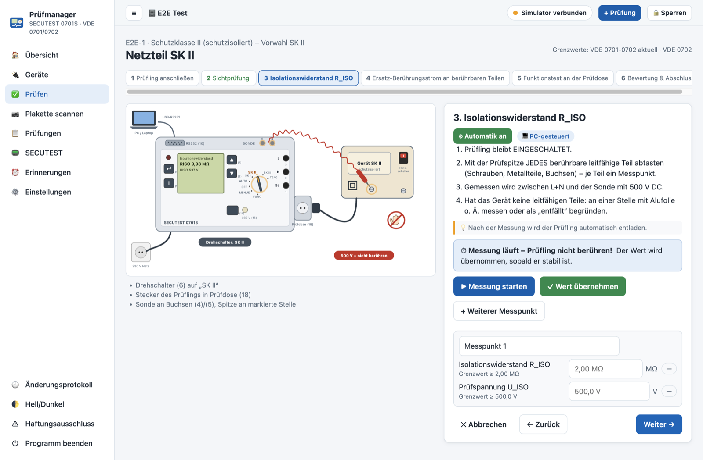

### Neu
* **Eigenes Programmfenster** mit Menü und Programm-Icon, startet maximiert. Es läuft immer nur ein Fenster; ein zweiter Start holt es nach vorn.
* **Fenster schließen beendet das Programm** sauber: Datenbank gesperrt, SECUTEST getrennt. Bei einer nicht gespeicherten Prüfung fragt das Programm vorher nach.
* **Prüfprotokoll und Prüfplaketten** öffnen sich in eigenen Programmfenstern; Drucken bzw. „Als PDF sichern“ über den Druckdialog. Externe Links öffnen im Standardbrowser.
* **Installer und Pakete für alle Systeme:** Windows-Installer und portable Version (x64, ARM64), macOS-.dmg (Universal, Apple Silicon, Intel), Linux als AppImage, deb, rpm, pacman (Arch), tar.gz (x64, ARM64) sowie Snap und Flatpak.
* **Protokolldateien** zur Fehlersuche über *Hilfe → Protokolldateien öffnen*.
* **Automatik auch im Modus „gerätegeführt“:** Das SECUTEST fährt seinen eigenen Prüfablauf (z. B. SK II: R_ISO → Ableitstrom → Funktionstest). Das Programm drückt Start bzw. ↵, liest jeden Schritt mit, trägt den stabilen Wert ein und schaltet weiter. Den Funktionstest erreicht das Gerät von selbst: Der Prüfer bestätigt „Prüfling ausschalten“, führt ihn durch und beantwortet „bestanden?“; danach holt das Programm das Protokoll des SECUTEST ab. Nimmt das Gerät einen Tastendruck über die Schnittstelle nicht an, bittet das Programm, ↵ am Gerät zu drücken.
* **„Hände weg“ vor der Prüfspannung:** Vor der ersten Messung mit 500 V bestätigt der Prüfer einmal, dass niemand den Prüfling berührt. War ein Messwert unruhig (z. B. Prüfling berührt), hält die Automatik an, statt einen verfälschten Wert zu übernehmen.
* PC-gesteuert: Für den Funktionstest schaltet das Programm nur die Fernsteuerung ab und stellt am SECUTEST nichts um.

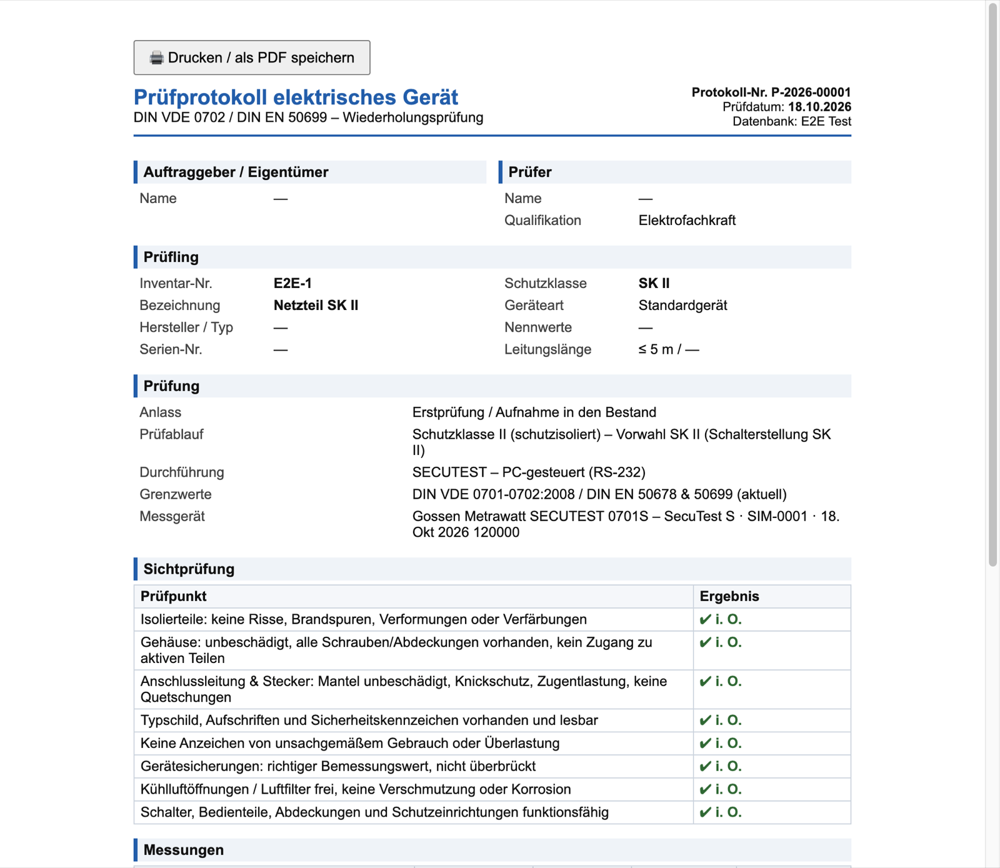

### Behoben
* Prüfprotokoll, Plaketten, Anhänge und Kalender-Download wurden durch den Schutz gegen veraltete Browser-Tabs (1.3.1) fälschlich abgewiesen.

### Hinweise
* Alpine Linux und andere musl-Systeme werden nicht mehr unterstützt (Electron gibt es nur für glibc).
* Ohne Fenster im Browser läuft das Programm weiterhin über `npm start` (Entwicklung).
* Jedes Release wird gepackt getestet: Selbsttest und ein kompletter Prüfdurchlauf in der Oberfläche (Simulator) auf Windows, macOS und Linux, Installation in sieben Linux-Distributionen.

## 1.3.1 – Schnittstelle am echten SECUTEST korrigiert

Am echten SECUTEST S (Firmware GTM5015000R0001, USB-RS232-Adapter FTDI) getestet: Anschlusskontrolle, R_ISO, Ersatz-Ableitstrom über die Sonde, Funktionstest und Protokollabruf, PC-gesteuert und gerätegeführt.

### Behoben
* **„⚠ Prüfsumme abweichend“ und Zeitüberschreitungen:** Nach dem ersten Befehl liefen alle weiteren ins Leere. Das Gerät schickt nach jeder Antwort ein Eingabezeichen „>“ (nach dem Abschalten der Fernsteuerung zusätzlich ^C), und das landete vor der nächsten Antwort.
* **Quittungen** im Format des Geräts (`.Yx`, `.Nx`, `.Ex`) werden erkannt. Vorher lief jeder Befehl, der etwas schaltet oder startet, in eine Zeitüberschreitung.
* **Messwerte mit Einheit** (`28:00.18mA`, `>310.0MΩ`) werden gelesen und auf die Einheit der Messgröße umgerechnet, z. B. kΩ in MΩ. Ein Wert mit unpassender Einheit wird verworfen statt falsch skaliert übernommen.
* **Antworten mit falscher Prüfsumme** werden nie übernommen. Abfragen wiederholt das Programm sofort, Befehle nicht, damit z. B. kein Tastendruck doppelt ankommt.
* **Vertauschte Zeichen**, die die Prüfsumme nicht erkennt: Das Gerät verdreht gelegentlich den Anfang einer Antwort („0A“ statt „A0“). Werte für das Prüfprotokoll und das Geräteprotokoll (PRO?) werden deshalb zweimal gleich gelesen, und der Anschlussstatus wechselt erst nach zwei gleichen Meldungen.
* **Funktionstest:** Werte werden nur übernommen, solange der Funktionstest wirklich läuft (Netz an der Prüfdose). Vorher ließ sich ein Funktionstest dokumentieren, der nie stattgefunden hat.
* Kurzschlusstest (MES!1) mit längerer Wartezeit, Geräte-ID ohne Füllzeichen, elektrische Arbeit (kWh) wird übernommen.
* **R_ISO sprang stark statt stabil „>310 MΩ“ zu zeigen:** Bei etwa 5 Abfragen pro Sekunde bricht der SECUTEST die Messung ab und startet sogar neu (am Gerät gemessen). Zwischen zwei Befehlen liegen jetzt immer mindestens 250 ms; während einer Messung fragt das Programm höchstens einmal pro Sekunde ab.
* **Hängt sich auf, liest keine Daten mehr:** Live-Anzeigen fragten in festem Takt, auch wenn die vorige Antwort noch fehlte – bei langsamem oder stummem Gerät stauten sich die Anfragen endlos. Die nächste Abfrage startet jetzt erst nach der vorigen, gleiche Abfragen werden zusammengelegt.
* **Findet den SECUTEST nicht von allein:** Die Suche hatte denselben „>“-Fehler wie der Treiber und gab nach einer „beschäftigt“-Antwort auf. Solange keine Verbindung besteht, fragt sie die USB-Adapter jetzt alle 10 s erneut an (z. B. SECUTEST erst nach dem Programmstart eingeschaltet). Bluetooth-Geräte werden nicht mehr angefragt.
* **macOS: Nach dem Schließen des Browser-Tabs ließ sich das Programm nicht mehr öffnen:** Die App lief unsichtbar weiter, und macOS ignorierte jeden weiteren Doppelklick. Jetzt öffnet jeder Doppelklick die Oberfläche; eine hängende alte Instanz wird erkannt, beendet und neu gestartet. Protokoll unter `~/Library/Logs/Secutest Pruefmanager/server.log`.
* **Mehrere Browser-Tabs:** Ein neuer Tab pausiert die älteren („Hier weiterarbeiten“), ein Tab von vor einem Neustart wird erkannt und kann das Gerät nicht mehr steuern. Nach einem Neustart lädt sich die Oberfläche selbst neu.
* Die Statusanzeige meldet „SECUTEST antwortet nicht“; nach dem Aus- und Einschalten des Geräts verbindet sich das Programm von selbst wieder.

### Neu
* **Automatik im Modus „PC-gesteuert“:** Anschlusskontrolle, danach misst das Programm jeden Schritt selbst (3 s Vorwarnung), wartet auf einen stabilen Wert, trägt ihn ein, bewertet und schaltet weiter. Bei einem Grenzwertverstoß hält es an; pausieren geht jederzeit. Die Sichtprüfung bleibt beim Prüfer.
* **Funktionstest am SECUTEST:** Das Programm gibt die Tasten frei (Fernsteuerung aus), der Prüfer führt den Funktionstest am Gerät durch und übernimmt die Werte mit „📥 Werte vom SECUTEST übernehmen“. Ist er beim „Weiter“ noch nicht abgeschlossen, erinnert das Programm daran.
* Live-Anzeige zeigt zusätzlich den **Anzeigewert des Displays**. Übernommen wird wie im Geräteprotokoll der Wert inkl. Gebrauchsfehler.
* Gerätegeführt: Meldet das SECUTEST „Protokoll fertig“, holt das Programm das Ergebnis im Schritt „Bewertung“ automatisch ab.

## 1.3.0 – QR-Scanner, Serienprüfung, Intervallvorschlag nach DGUV V3, Kalibrier-Erinnerung

### Neu: Prüfplaketten scannen
Neuer Menüpunkt **📷 Plakette scannen**. Drei Wege führen zum Gerät:
* **Kamera:** Webcam oder eingebaute Kamera auf den QR-Code der Prüfplakette richten.
* **USB-Handscanner:** Die Scanner arbeiten wie eine Tastatur, einfach auslösen. Eintippen geht genauso, auch mit Inventar- oder Seriennummer.
* **Foto/Bild:** ein Bild der Plakette auswählen.

Danach wahlweise *Gerät anzeigen*, *gleich prüfen* oder *hier bleiben* und die nächste Plakette scannen. Neue Plaketten tragen im QR-Code eine kurze Kennung der Datenbank. Gehört eine Plakette zu einer anderen Datenbank, sagt das Programm das deutlich. Ältere Plaketten funktionieren weiterhin.

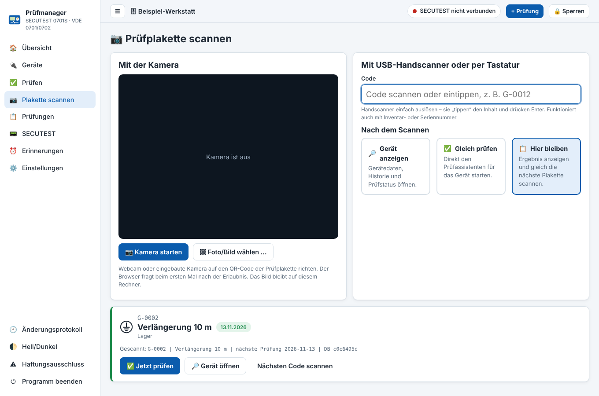

### Neu: Serienprüfung gleicher Geräte
* **⧉× Mehrfach anlegen** (im Gerätedetail): z. B. aus einer Verlängerungsleitung 10 identische machen. Jede Kopie bekommt eine eigene Inventarnummer, auf Wunsch durchnummeriert („#1“, „#2“ …).
* **▶ Serienprüfung** für mehrere ausgewählte Geräte (Geräteliste) oder direkt nach dem Mehrfach-Anlegen. Die Geräte werden nacheinander geprüft:
  * Prüfablauf, Durchführung, Norm, Grenzwerte und Prüfer werden vom vorherigen Gerät übernommen.
  * Die Sichtprüfung lässt sich vorausfüllen, mit dem deutlichen Hinweis, jeden Punkt am Gerät zu kontrollieren.
  * Eine Leiste zeigt den Fortschritt. Geräte lassen sich überspringen.
  * Am Ende gibt es eine Übersicht mit allen Ergebnissen und **Prüfplaketten für alle bestandenen Geräte** auf einen Klick.

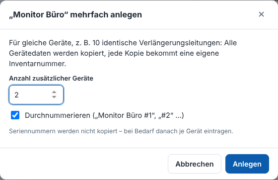 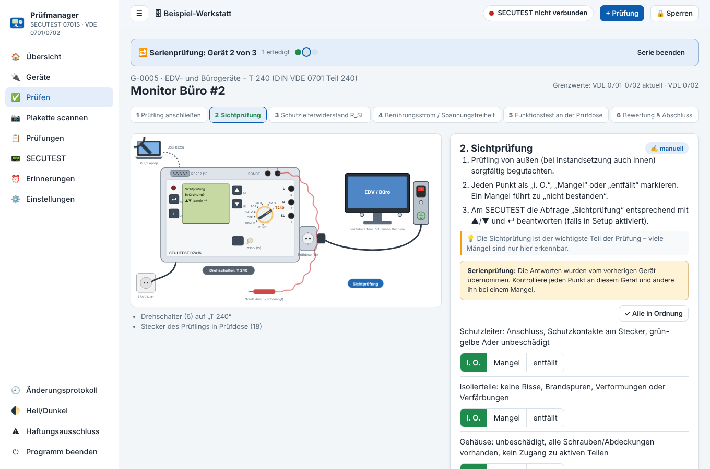

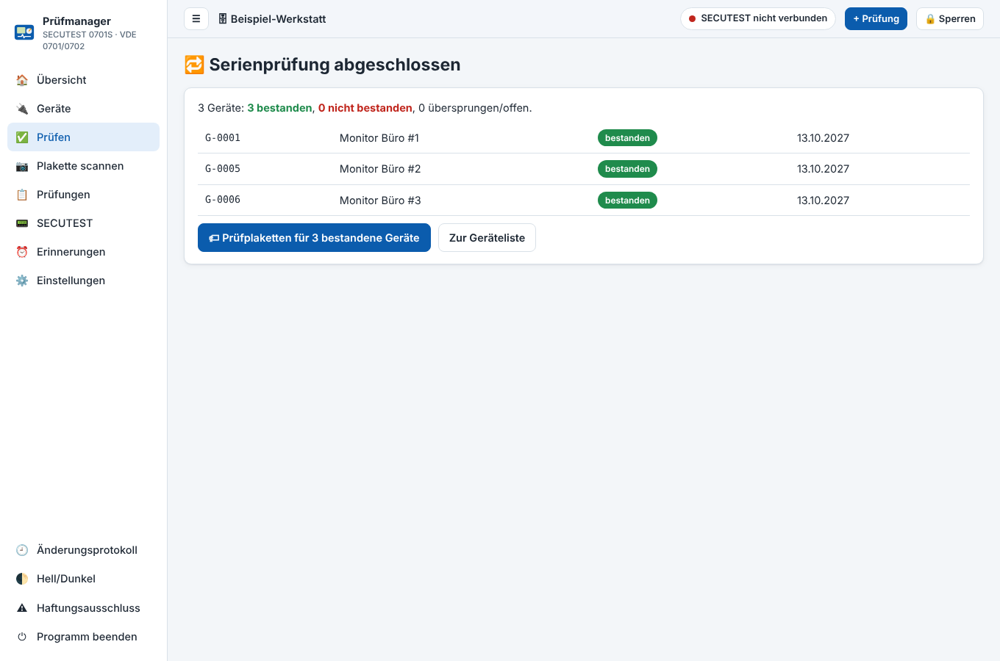

### Neu: Intervallvorschlag nach DGUV Vorschrift 3
Jedes Gerät hat jetzt einen **Einsatzbereich**: Baustelle, Werkstatt/Fertigung, Büro oder Privathaushalt. Den Standard für neue Geräte legst du in den Einstellungen fest. Der Knopf **💡 Vorschlag nach DGUV V3** steht im Geräteformular und im Dialog „Prüfintervall ändern“ (dort je Gerät). Er schlägt das Prüfintervall nach DGUV Vorschrift 3, Tabelle 1B vor:
* **Richtwert:** 6 Monate, auf Baustellen 3 Monate.
* **Verlängerung** bis zum **Maximalwert** (Werkstatt 1 Jahr, Büro 2 Jahre), wenn die **Fehlerquote** der Datenbank in den letzten 24 Monaten **unter 2 %** liegt. Dafür braucht es mindestens 10 Prüfungen.
* **Kürzer** bleibt es bei Geräten, die schon einmal durchgefallen sind. Verlängerungsleitungen bekommen höchstens 12 Monate.
* **Privathaushalt:** Hier gilt die DGUV V3 nicht. Das Programm empfiehlt 12 Monate, bei seltener Nutzung bis 24.

Jeder Vorschlag nennt seine Begründung. Er ist ohne Gewähr; maßgeblich bleibt die Gefährdungsbeurteilung des Betreibers.

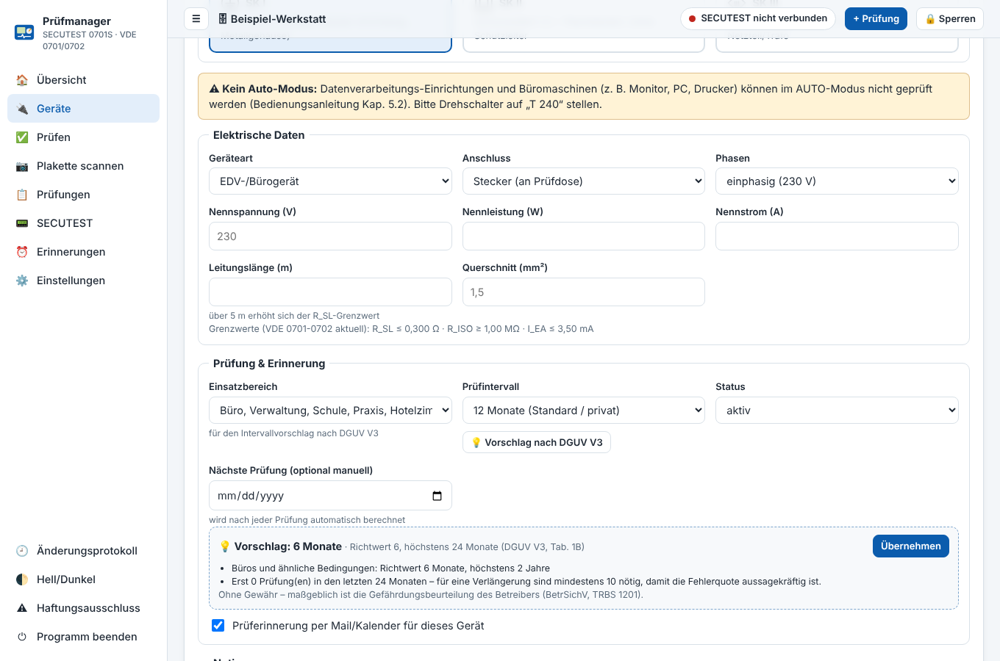

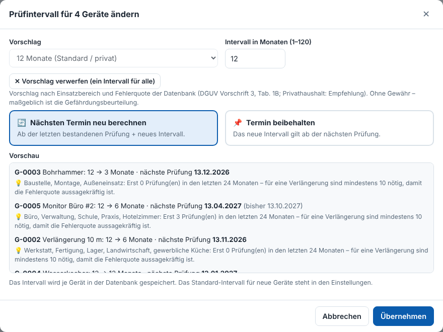

### Neu: Kalibrier-Erinnerung für das SECUTEST
Unter *Einstellungen → Programm* lässt sich die Erinnerung **ein- und ausschalten**. Einzutragen sind:
* Datum der letzten Kalibrierung, Kalibrierintervall und Vorwarnzeit,
* Geräte-ID, Kalibrier-Nr. und Labor bzw. Zertifikat.

Geräte-ID und Kalibrier-Nr. lassen sich per IDN? aus dem verbundenen Gerät übernehmen.

Mit eingeschalteter Erinnerung:
* Rechtzeitig vor dem Ablauf warnen die **Übersicht** und der **Prüfassistent**.
* Der Kalibrierstand steht in **jedem Prüfprotokoll**.
* Den Termin gibt es als Kalenderdatei (.ics).
* Meldet das SECUTEST eine neue Kalibrier-Nr., weist das Programm darauf hin.

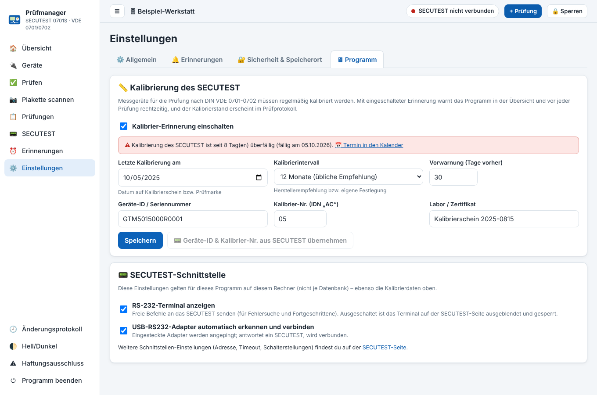

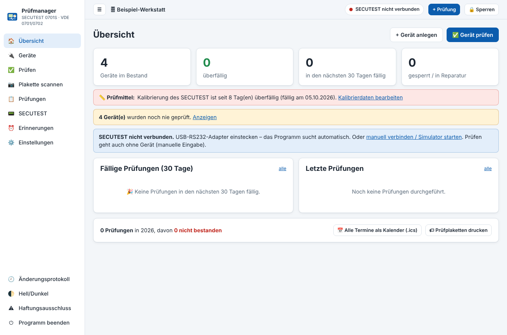

### Verbessert
* **Release-Seite:** Die Download-Tabelle nennt ausschließlich Dateien, die wirklich im Release liegen. Vor dem Veröffentlichen prüft ein Schritt, ob alle Pflichtpakete gebaut wurden; sonst wird nicht veröffentlicht. Fehlt ausnahmsweise ein optionales Paket (Flatpak, Snap, ARM64-AppImage), steht das unter „Diesmal nicht enthalten“. Die Prüfung läuft bereits in Pull Requests.
* Neue Tests für Intervallvorschlag, Mehrfach-Anlegen, Plaketten-Suche und Kalibrierung (jetzt 47 Tests).

## 1.2.0 – Passwort & 2FA optional, Speicherort frei wählbar, Erinnerungen nach Wunsch

### Neu: Passwort und Zwei-Faktor-Anmeldung sind freiwillig
Beim Anlegen einer Datenbank wählst du selbst: **mit oder ohne Passwort** (Verschlüsselung AES-256) und **mit oder ohne Zwei-Faktor-Anmeldung**. Beides bleibt empfohlen und lässt sich jederzeit unter *Einstellungen → Sicherheit & Speicherort* ändern:

* **Passwort festlegen:** Die bisher offene Datei wird verschlüsselt. Danach bietet das Programm an, alte unverschlüsselte Sicherungen zu löschen.
* **Passwort ändern** oder **entfernen**. Beim Entfernen wird die Datei nach einer deutlichen Warnung entschlüsselt.
* **2FA einrichten**, **neu einrichten** (z. B. bei neuem Handy) oder **abschalten**. Beim ersten Einschalten gibt es 10 Wiederherstellungscodes.
* Kritische Änderungen bestätigst du mit dem App-Code, ohne 2FA mit dem Passwort. **Neu:** Ist das Handy weg, geht das auch mit einem **Wiederherstellungscode**.
* Datenbanken ohne Passwort sind in der Liste mit **🔓 ohne Passwort** markiert und öffnen sich mit einem Klick.

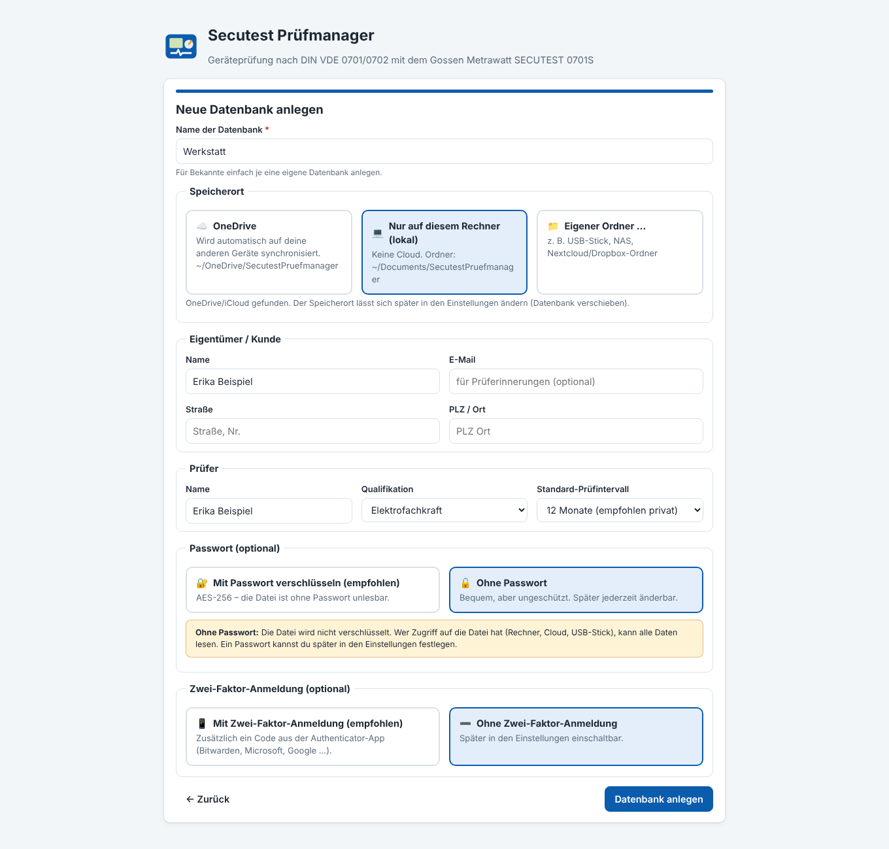

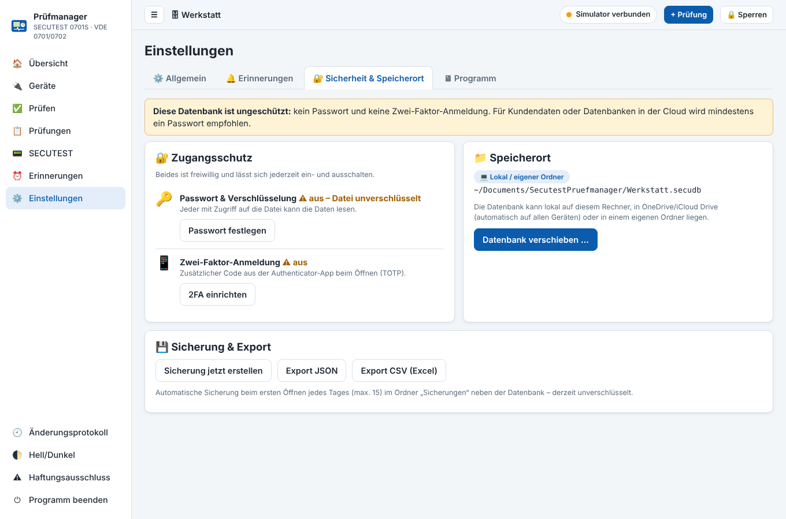

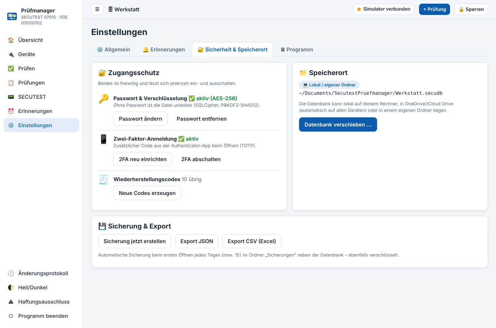

### Neu: Datenbank lokal, in der Cloud oder im eigenen Ordner – und verschiebbar
* Speicherort beim Anlegen: **OneDrive/iCloud Drive**, **nur auf diesem Rechner (lokal)** oder ein **eigener Ordner** (USB-Stick, NAS, Nextcloud …).
* **Datenbank verschieben**, z. B. von lokal nach OneDrive und zurück. Ablauf: Sicherung → Kopie → Kopie öffnen und prüfen → Original entfernen. Die Sicherungen ziehen mit um, und du bleibst angemeldet.

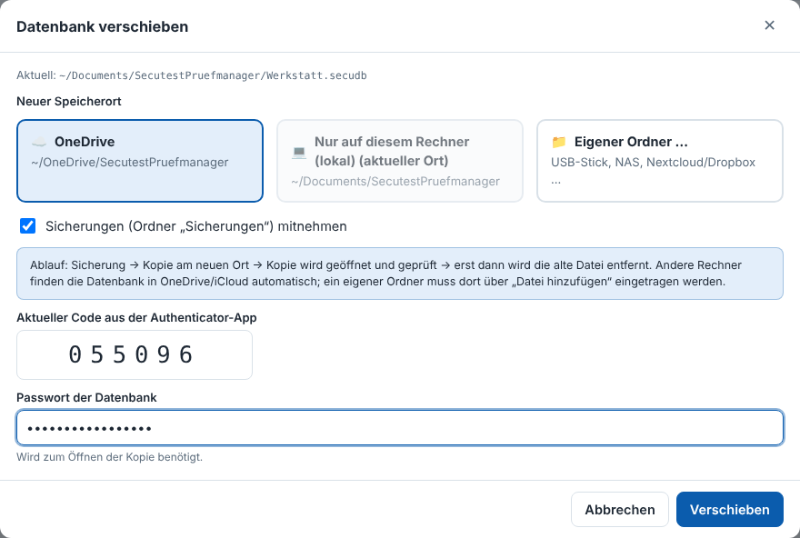

### Neu: Erinnerungen nach Wunsch – E-Mail, Kalender, monatlich gebündelt
Unter *Einstellungen → Erinnerungen* wählst du, **wie** du erinnert wirst (**E-Mail**, **Kalender** oder **beides**) und **wann**:
* **zum Fälligkeitstermin**: jedes Gerät einzeln zu seinem Termin, oder
* **monatsweise gebündelt**: eine Sammelmail bzw. ein Sammeltermin am Monatsersten mit allen in diesem Monat fälligen Geräten. Überfällige Geräte erscheinen jeden Monat erneut.

Kalendertermine haben jetzt eine feste ID. Ein erneuter Import oder eine automatische Kalendereinladung **aktualisiert** den vorhandenen Termin, statt ihn zu verdoppeln. Verschobene Termine wandern mit, leere Monate werden abgesagt.

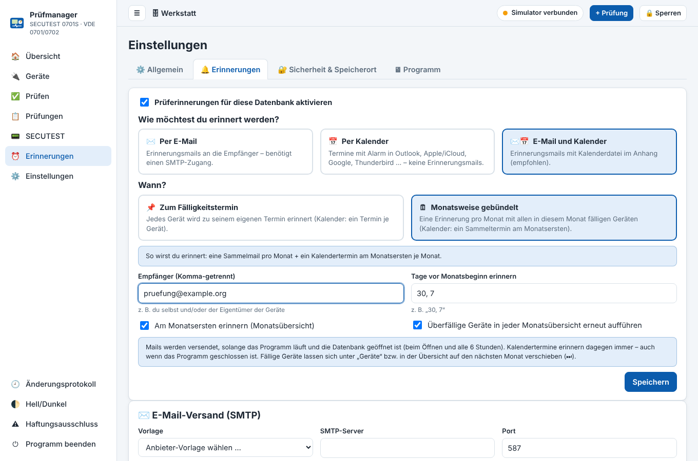

### Neu: Fällige Prüfungen verschieben, Prüfintervall je Gerät ändern
* **⏭ Auf den nächsten Monat verschieben** (oder auf ein Datum): einzeln aus der Übersicht, „alle verschieben“ oder für mehrere ausgewählte Geräte in der Geräteliste. Eine Begründung landet im Änderungsprotokoll. Der ursprüngliche Termin bleibt bis zur nächsten Prüfung sichtbar (**„⏭ verschoben“**).
* **⏱ Prüfintervall ändern** für ein oder mehrere Geräte, gespeichert **je Gerät in der Datenbank**, mit Vorschau der neuen Termine. Wahlweise wird der nächste Termin neu berechnet oder beibehalten.

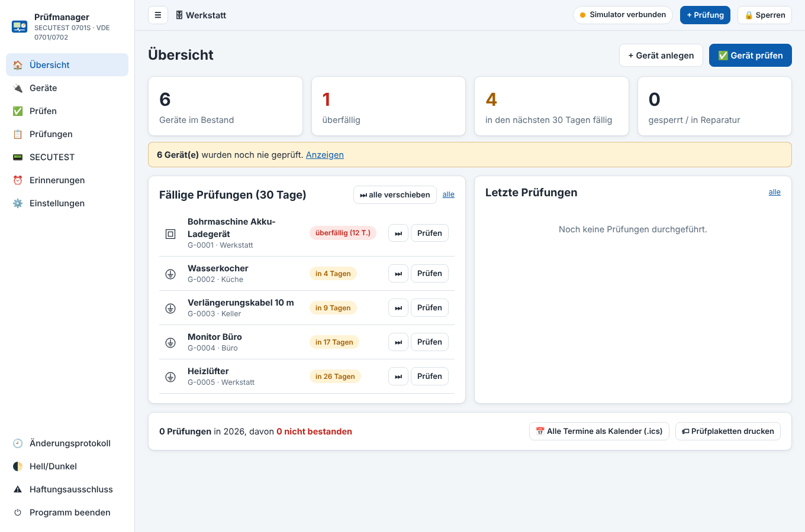

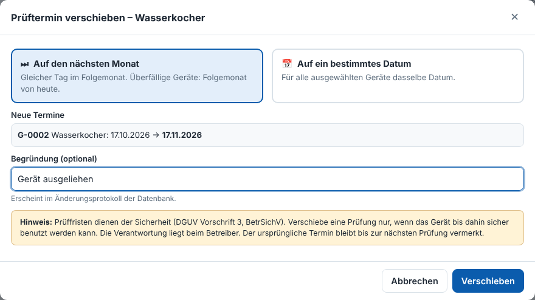 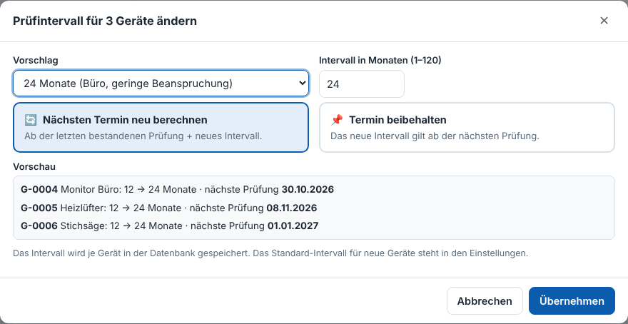

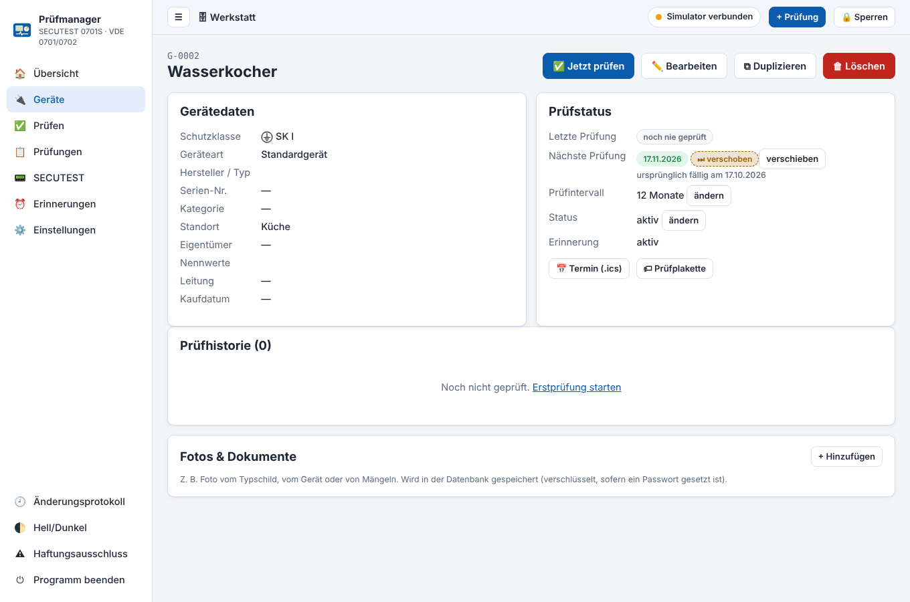

### Neu: RS-232-Terminal ein- und ausschaltbar
Unter *Einstellungen → Programm* lässt sich das Terminal auf der SECUTEST-Seite abschalten. Es ist dann ausgeblendet und auch über die Schnittstelle gesperrt.

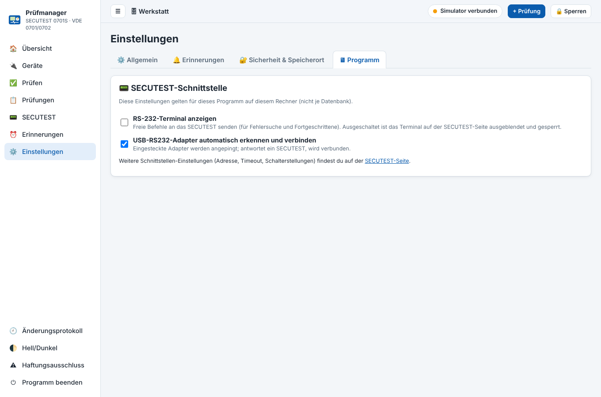

### Verbessert
* Einstellungen mit Unterreitern: **Allgemein · Erinnerungen · Sicherheit & Speicherort · Programm**.
* Behoben: Die Auswahl „Qualifikation“ beim Anlegen einer Datenbank war leer.
* Behoben: Die Warnung „Nur noch … Wiederherstellungscodes“ erschien auch ohne 2FA.
* Das Erinnerungsskript (`npm run reminders`) fragt bei Datenbanken ohne Passwort kein Passwort mehr ab.
* Release-Test für openSUSE gegen kurzzeitig gestörte Spiegelserver abgesichert.
* Neue Tests für Verschlüsselung an/aus, optionale 2FA, Verschieben der Datenbank, Termine verschieben, Intervalländerung, monatliche Bündelung und Terminal-Schalter (jetzt 42 Tests).

## 1.1.0 – Pakete für alle Plattformen, „Programm beenden“

_Nicht als eigenes Release erschienen: Die Veröffentlichung wurde durch einen gestörten openSUSE-Spiegelserver blockiert. Alle Inhalte sind ab 1.2.0 enthalten._

### Neu: Installationspakete für fast jedes System

Zu jedem Release gehören jetzt fertige Pakete mit eigenem Programm-Icon, fast alle mit integriertem Node.js:

| System | Paket |
|---|---|
| **Windows** x64 und **ARM64** (Snapdragon, Surface) | `.zip` mit `Secutest-Pruefmanager.cmd` |
| **macOS Universal** (Apple Silicon + Intel), dazu getrennt arm64 und Intel | `.zip` mit **„Secutest Pruefmanager.app“** (eigenes Icon, Doppelklick) und `.command` |
| **Ubuntu, Linux Mint, Debian, Pop!_OS, Raspberry Pi OS** (x64 + ARM64) | `.deb` |
| **Fedora, openSUSE, RHEL/Alma/Rocky** (x64 + ARM64) | `.rpm` |
| **Arch, Manjaro, EndeavourOS** (x64 + ARM64) | `.pkg.tar.zst` |
| **Alpine Linux, postmarketOS** (x64 + ARM64) | `.apk` (nutzt das Node.js der Distribution) |
| **Jede Linux-Distribution** | `.AppImage` (x64 + ARM64), `.flatpak` (x64) und `.snap` (x64) |
| Linux portabel | `.tar.gz` (x64 + ARM64), dazu musl-Varianten für Void-musl & Co. |

* Die Linux-Pakete installieren das Programm nach `/opt/secutest-pruefmanager`. Sie legen einen **Startmenü-Eintrag mit Icon** an, inklusive Aktion „Mit Simulator starten“, und den Befehl `secutest-pruefmanager`.
* **Unterstützte Linux-Distributionen:** Ubuntu ab 22.04, Linux Mint ab 21, Debian ab 12, Fedora ab 35, RHEL/Alma/Rocky ab 9, openSUSE Tumbleweed/Leap 16, Arch/Manjaro/EndeavourOS, Raspberry Pi OS 64-Bit ab Bookworm, Alpine ab 3.19. Ältere Systeme nehmen das Flatpak. Die Pakete prüfen die Mindestanforderung (glibc ≥ 2.34) schon bei der Installation.
* Jedes Paket wird automatisch getestet: Selbsttest auf Windows, macOS und Linux sowie Installation in echten **Ubuntu-, Debian-, Fedora-, Rocky-, openSUSE-, Arch- und Alpine-Containern**, dazu Snap- und Flatpak-Installation auf Ubuntu. Zusätzlich laufen Tests auf ARM64-Hardware (Linux, Windows) und auf Intel-Macs.

### Neu: „Programm beenden“ und Einzelinstanz
Ein Startsymbol (macOS-App, Linux-Menü, AppImage, Flatpak) startet das Programm ohne Terminalfenster. Beenden lässt es sich deshalb jetzt direkt in der Oberfläche, über **⏻ Programm beenden** in der Seitenleiste oder auf der Anmeldeseite. Startet man das Programm ein zweites Mal, öffnet sich einfach das bereits laufende im Browser.

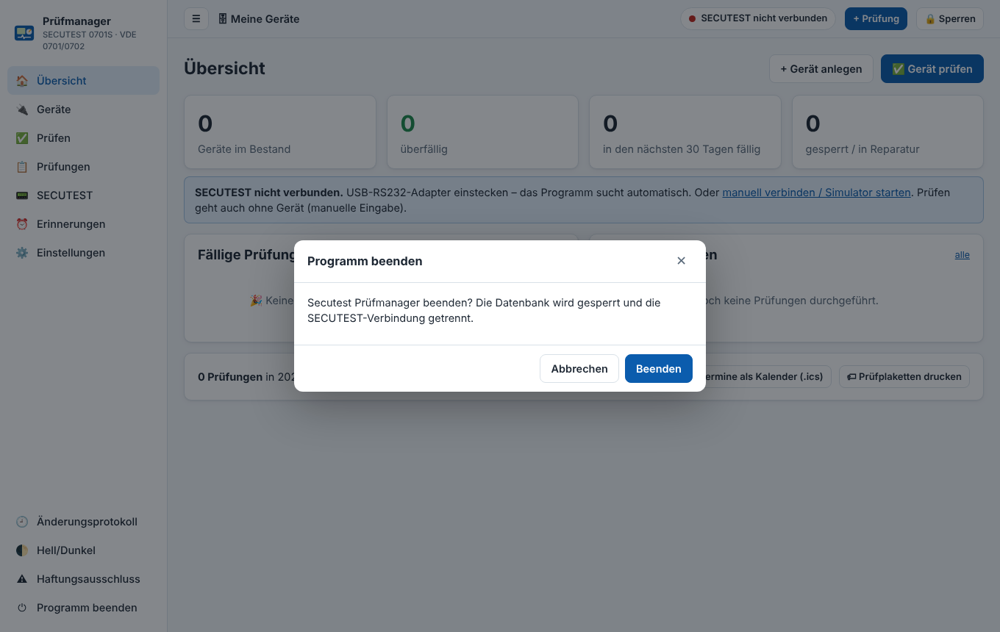

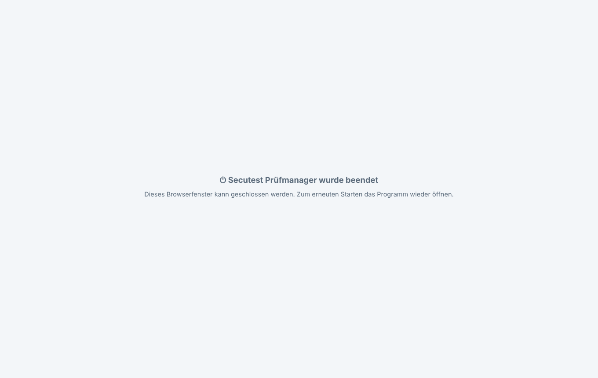

### Verbessert
* Der Haftungsausschluss steht jetzt ganz oben auf der GitHub-Seite.
* Die Release-Notizen enthalten automatisch den Abschnitt aus diesem Änderungsprotokoll, samt Bildern.
* Behoben: Die Einträge „Hell/Dunkel“, „Haftungsausschluss“ und „Programm beenden“ in der Seitenleiste waren immer als aktiv markiert.

## 1.0.0 – Erste Version

* Prüfabläufe nach DIN VDE 0701/0702 für AUTO, SK I, SK II, SK III, T 240 (EDV/Büro), Verlängerungsleitungen (EL1) und Festanschluss; der AUTO-Modus wird für EDV-Geräte, SK III, Leitungen und Festanschluss automatisch gesperrt.
* RS-232-Steuerung des SECUTEST 0701S (gerätegeführt, PC-gesteuert, manuell), Auto-Ping/Hot-Plug-Erkennung, Simulator, Terminal.
* Animierte Grafik zu jedem Prüfschritt.
* Verschlüsselte Datenbanken (SQLCipher) in OneDrive/iCloud, mehrere getrennte Datenbanken, 2FA (TOTP), Wiederherstellungscodes.
* Bewertung nach aktueller Norm oder den SECUTEST-Grenzwerten von 1997, Maßnahmenliste bei „nicht bestanden“.
* Prüferinnerungen per E-Mail und Kalender (.ics), Prüfprotokoll, Prüfplaketten mit QR-Code, Export.

