# Secutest Prüfmanager

**Freies Prüf- und Datenbankprogramm für den Gossen Metrawatt SECUTEST 0701S / 0702S. Damit prüfst du elektrische Geräte nach DIN VDE 0701/0702, verwaltest sie und katalogisierst sie.**

Das Programm steuert das Prüfgerät über die eingebaute RS-232-Schnittstelle und führt dich Schritt für Schritt mit Grafiken durch jede Prüfung. Alle Messwerte landen in einer verschlüsselten Datenbank, die in OneDrive oder iCloud Drive liegen kann. Die Anmeldung ist per Zwei-Faktor-Code geschützt (Bitwarden, Microsoft oder Google Authenticator), und an fällige Prüfungen erinnert das Programm per E-Mail oder Kalender.
Es geht auch **ganz ohne Prüfgerät**: Messwerte lassen sich von Hand eintragen, oder du nimmst den eingebauten Simulator.

> [!CAUTION]
> **Sicherheitshinweis und Haftungsausschluss.** Prüfungen nach DIN VDE 0701/0702 und alle Arbeiten an elektrischen Anlagen und Geräten dürfen **nur Elektrofachkräfte** durchführen, oder elektrotechnisch unterwiesene Personen unter Leitung und Aufsicht einer Elektrofachkraft. **Elektrischer Strom ist lebensgefährlich.**
> Dieses Projekt ist **Open Source und ohne Gewähr**. Es **kann Fehler enthalten**, etwa bei Grenzwerten, Bewertungen, der Gerätekommunikation oder den Anleitungen. Die Autoren übernehmen, soweit gesetzlich zulässig, **keine Haftung für Personen-, Sach- oder Vermögensschäden**. Die Software ersetzt weder die Bedienungsanleitung des Prüfgeräts noch die gültigen Normen oder dein fachliches Urteil. Den vollständigen Text findest du unter [Haftungsausschluss](#haftungsausschluss).

<p align="center">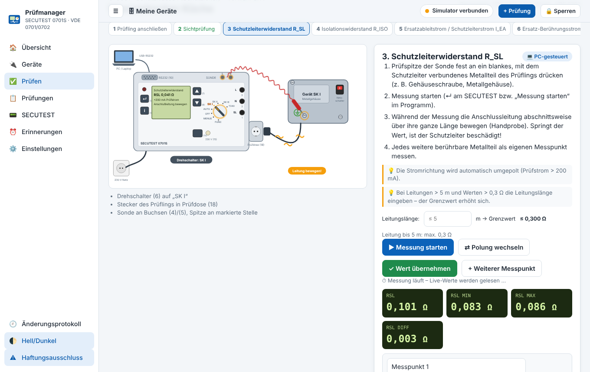</p>

---

## Inhalt

1. [Funktionen im Überblick](#funktionen-im-überblick)
2. [Download & Start](#download--start)
3. [Erste Schritte](#erste-schritte)
4. [SECUTEST anschließen (RS-232)](#secutest-anschließen-rs-232)
5. [Prüfen: Betriebsarten](#prüfen-betriebsarten)
6. [Prüfabläufe je Schutzklasse](#prüfabläufe-je-schutzklasse)
7. [Grafische Schritt-Erklärungen](#grafische-schritt-erklärungen)
8. [Grenzwerte & Bewertung](#grenzwerte--bewertung)
9. [Nicht bestanden – was nun?](#nicht-bestanden--was-nun)
10. [Datenbanken, Cloud & Sicherheit](#datenbanken-cloud--sicherheit)
11. [Prüferinnerungen per E-Mail & Kalender](#prüferinnerungen-per-e-mail--kalender)
12. [Protokolle, Prüfplaketten, Export](#protokolle-prüfplaketten-export)
13. [Gespeicherte Daten](#gespeicherte-daten)
14. [Entwicklung & automatische Releases](#entwicklung--automatische-releases)
15. [Ideen für weitere Funktionen](#ideen-für-weitere-funktionen)
16. [Fehlerbehebung (FAQ)](#fehlerbehebung-faq)
17. [Haftungsausschluss](#haftungsausschluss) · [Lizenz](#lizenz)

---

## Funktionen im Überblick

| Bereich | Was das Programm kann |
|---|---|
| **Prüfen nach VDE 0701/0702** | Fertige Abläufe für **AUTO** (automatische SK-I/SK-II-Erkennung), **SK I**, **SK II**, **SK III**, **T 240** (EDV/Büro), **Verlängerungsleitungen** (Adapter EL1) und **Festanschluss** (Einzelmessungen) |
| **Auto-Modus-Schutz** | Sperrt den AUTO-Modus automatisch bei **EDV-/Bürogeräten** (Monitor, PC, Drucker …), **SK III**, Leitungen und Festanschluss und schlägt den richtigen Ablauf vor. Das entspricht der Bedienungsanleitung, Kap. 5.2 |
| **RS-232-Steuerung** | Gerätegeführt mit Live-Anzeige und Ergebnis-Übernahme (`PRO?`) oder PC-gesteuert (`MES!`/`WER?`). Dazu Fernbedienung, Terminal und Protokollmitschnitt |
| **Auto-Ping & Hot-Plug** | Findet das SECUTEST automatisch an jedem USB-RS232-Adapter unter Windows, macOS und Linux |
| **Manueller Betrieb** | Geräte anlegen, prüfen und bearbeiten **ohne** Prüfgerät, auf Wunsch mit Gebrauchsfehler-Korrektur der Anzeigewerte |
| **Grafische Anleitung** | Zu jedem Prüfschritt eine animierte Skizze: Drehschalterstellung, Prüfdose, Sonde, Messpunkt und Handgriff (Leitung bewegen, Stecker drehen …) |
| **Bewertung** | Automatisch nach **aktueller Norm** (DIN VDE 0701-0702:2008, DIN EN 50678/50699) oder nach den **Gerätegrenzwerten von 1997**. Weicht die Bewertung des SECUTEST ab, zeigt das Programm einen Hinweis |
| **Maßnahmen** | Ist ein Gerät durchgefallen, wählst du aus einer Liste, wie es weitergeht (sperren, reparieren, Leitung tauschen, ausmustern …). Der Gerätestatus wird automatisch gesetzt |
| **Datenbank** | SQLite, verschlüsselt mit **SQLCipher (AES-256)**. Liegt direkt in **OneDrive** oder **iCloud Drive**. Beliebig viele, voneinander getrennte Datenbanken, z. B. für Bekannte |
| **Anmeldung** | Passwort plus **Zwei-Faktor-Code (TOTP)** aus Bitwarden, Microsoft oder Google Authenticator, Aegis, 2FAS …, dazu Wiederherstellungscodes und automatische Sperre bei Inaktivität |
| **Prüftermine** | Prüfdatum wird automatisch eingetragen und der nächste Termin aus dem Prüfintervall berechnet. Intervall pro Gerät änderbar |
| **Erinnerungen** | E-Mail (SMTP) vor und bei Fälligkeit, **Kalendereinladung (.ics)** nach jeder Prüfung sowie Export aller Termine |
| **Dokumentation** | Druckfertiges **Prüfprotokoll** (PDF über den Browser), **Prüfplaketten mit QR-Code**, Fotos und PDFs pro Gerät, Änderungsprotokoll, Export als CSV und JSON |
| **Plattformen** | Windows, macOS (Apple Silicon und Intel), Linux. Fertige Pakete mit integriertem Node.js |

<table>
<tr>
<td>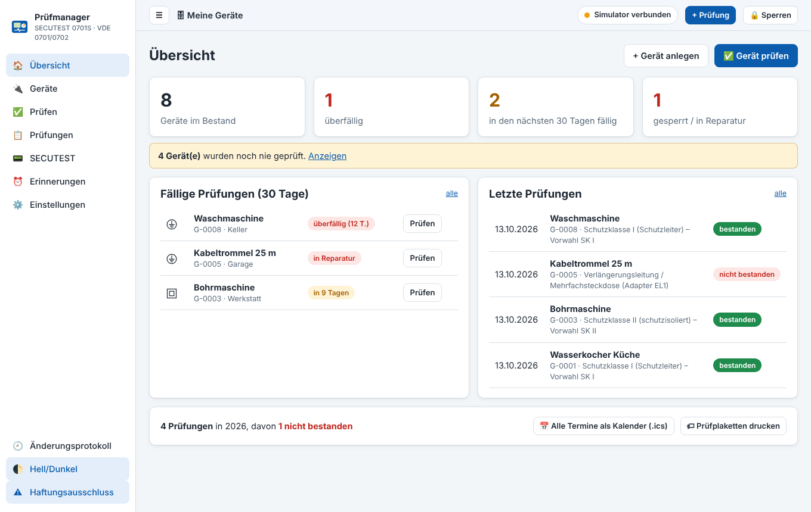<br><sub>Übersicht mit fälligen Prüfungen</sub></td>
<td>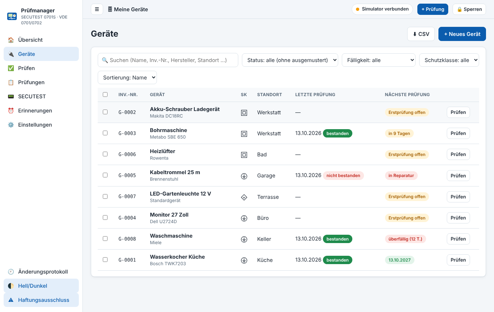<br><sub>Geräteliste mit Filtern und Fälligkeiten</sub></td>
</tr>
<tr>
<td>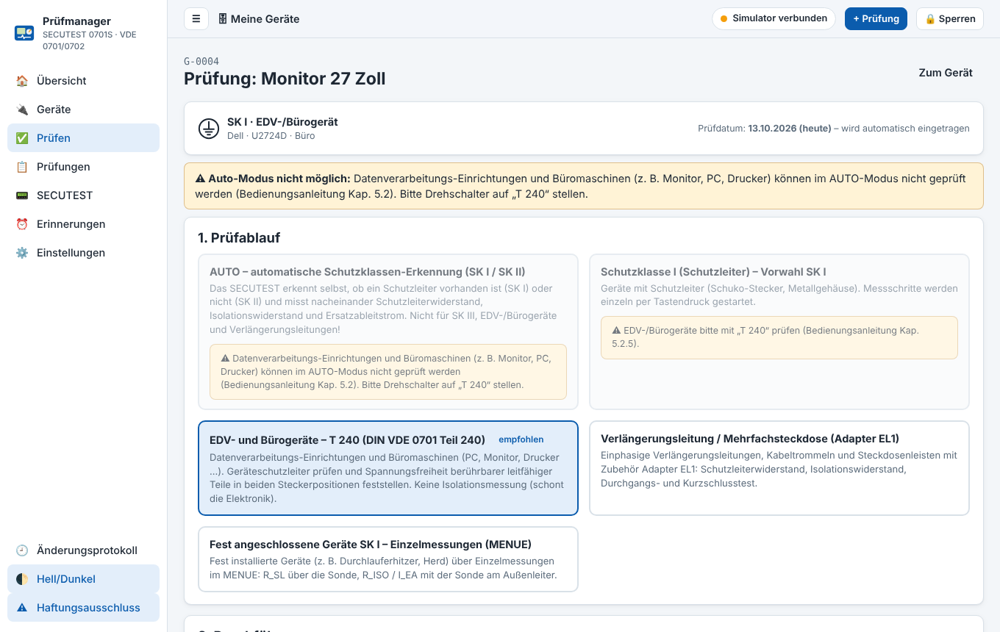<br><sub>Monitor erkannt: AUTO gesperrt, T 240 empfohlen</sub></td>
<td>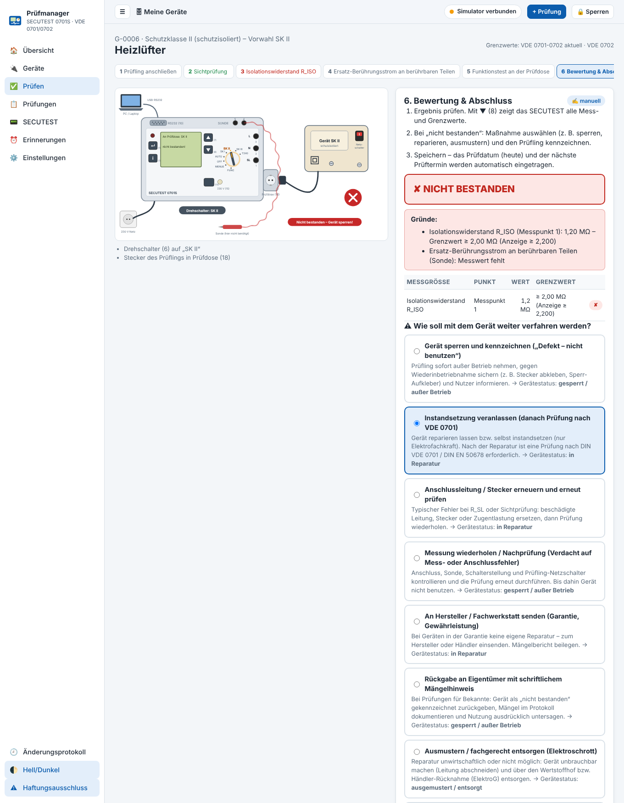<br><sub>Nicht bestanden: Gründe und Maßnahmenliste</sub></td>
</tr>
<tr>
<td>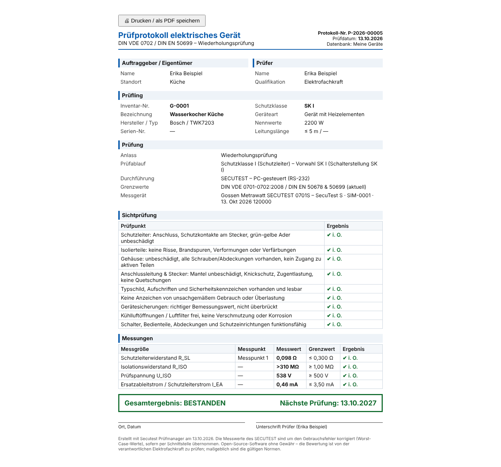<br><sub>Druckfertiges Prüfprotokoll</sub></td>
<td>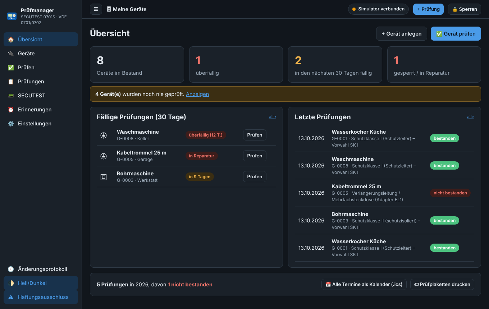<br><sub>Hell- und Dunkelmodus</sub></td>
</tr>
</table>

---

## Download & Start

### Fertige Pakete (empfohlen)

Bei jeder Änderung baut GitHub automatisch ein neues Release. Unter **[Releases → neueste Version](../../releases/latest)** lädst du das passende Paket herunter:

| System | Datei | Start |
|---|---|---|
| Windows 10/11 (64 Bit) | `Secutest-Pruefmanager-…-windows-x64.zip` | Entpacken, dann **`Secutest-Pruefmanager.cmd`** doppelklicken |
| macOS Apple Silicon (M1–M4) | `…-macos-arm64.zip` | Entpacken, dann Rechtsklick auf **`Secutest-Pruefmanager.command`** → *Öffnen* |
| macOS Intel | `…-macos-x64.zip` | wie oben |
| Linux x64 | `…-linux-x64.tar.gz` | `tar xzf …` und `./Secutest-Pruefmanager.sh` |

* Node.js ist **enthalten**, du musst nichts installieren.
* Der Browser öffnet sich automatisch unter **http://127.0.0.1:3701**. Das Programm ist nur auf deinem Rechner erreichbar.
* **Ohne Prüfgerät ausprobieren:** `Simulator-ohne-Hardware` starten.
* **Update:** neues Paket entpacken. Deine Datenbanken liegen nicht im Programmordner und bleiben erhalten.
* Prüfsummen der Pakete stehen in `SHA256SUMS.txt`.

<details>
<summary><b>Hinweise zu Windows SmartScreen / macOS Gatekeeper</b></summary>

* **Windows:** Bei „Der Computer wurde durch Windows geschützt“ klickst du auf *Weitere Informationen* → *Trotzdem ausführen*. Fragt die Firewall nach, genügt *Abbrechen*, denn der Server lauscht nur auf 127.0.0.1.
* **macOS:** Beim ersten Start Rechtsklick → *Öffnen*. Blockiert macOS weiterhin, einmalig im Terminal ausführen:
  `xattr -dr com.apple.quarantine ~/Downloads/Secutest-Pruefmanager-…`
* **Linux:** Für die serielle Schnittstelle muss dein Benutzer in der Gruppe `dialout` sein: `sudo usermod -aG dialout $USER`, danach neu anmelden.
</details>

### Aus dem Quellcode

Voraussetzung: [Node.js](https://nodejs.org) ab Version 20.

```bash
git clone <URL dieses Repositorys>
cd <Ordner>
npm install
npm start            # normal starten
npm run simulator    # mit simuliertem SECUTEST
npm test             # Tests
```

Optionen: `--port 3701`, `--host 127.0.0.1`, `--simulator`, `--no-open`, `--selftest`.

---

## Erste Schritte

### 1. Haftungsausschluss bestätigen

Beim ersten Start zeigt das Programm den Sicherheitshinweis. Er muss einmal bestätigt werden.

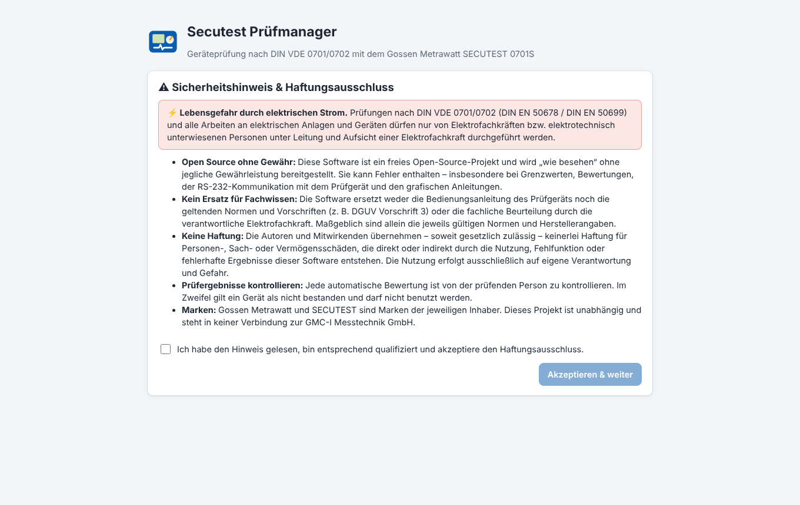

### 2. Datenbank anlegen

Unter **„+ Neue Datenbank“** vergibst du einen Namen, z. B. *Meine Geräte* oder *Familie Beispiel*, und wählst den Speicherort. Gefundene **OneDrive**- und **iCloud-Drive**-Ordner stehen direkt zur Auswahl (Unterordner `SecutestPruefmanager`). Dazu kommen Eigentümer, Prüfer, Standard-Prüfintervall und ein **Passwort**. Das Passwort verschlüsselt die Datei, ohne es ist sie nicht wiederherstellbar.

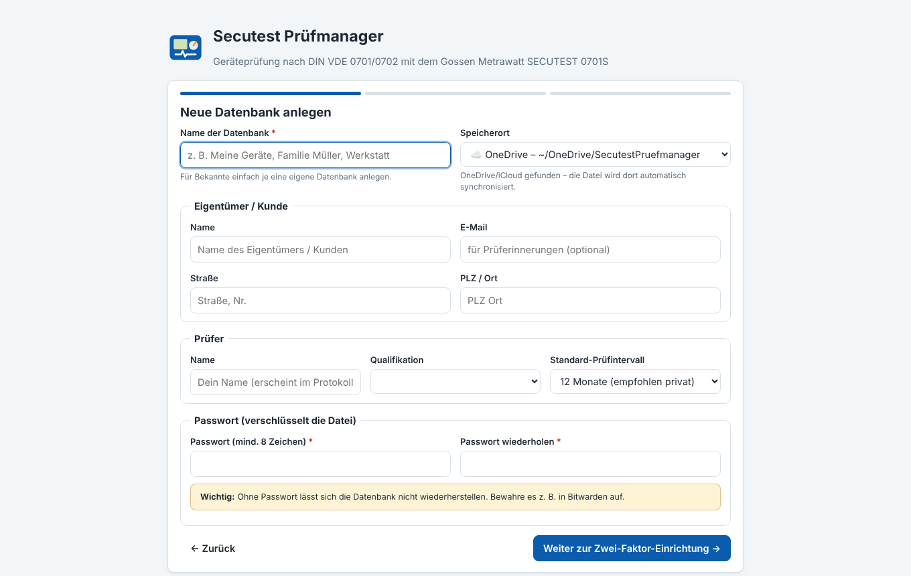

### 3. Zwei-Faktor-Anmeldung einrichten

Scanne den QR-Code mit deiner Authenticator-App, z. B. **Bitwarden Authenticator**, Microsoft Authenticator, Google Authenticator, Aegis oder 2FAS, und gib den 6-stelligen Code ein. Erst dann wird die Datenbank angelegt. Bewahre die **10 Wiederherstellungscodes** sicher auf, z. B. in Bitwarden. Damit kommst du auch ohne Handy an die Daten.

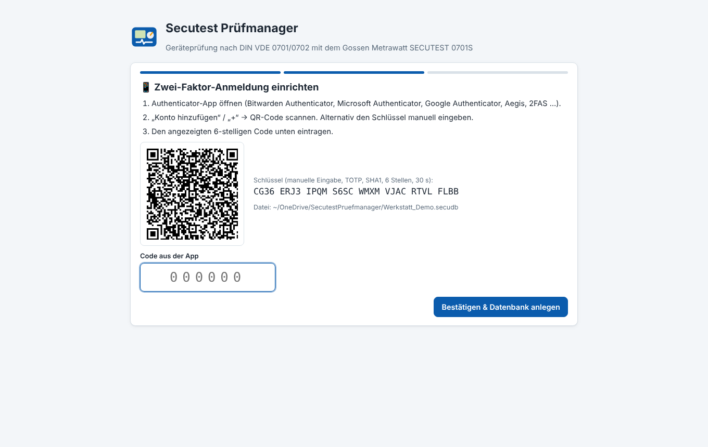

> TOTP (RFC 6238) ist ein offener Standard. Er funktioniert offline und kostenlos, ohne Konto bei einem Anbieter.

### 4. Anmelden

Datenbank wählen, Passwort eingeben, dann den Code aus der App.

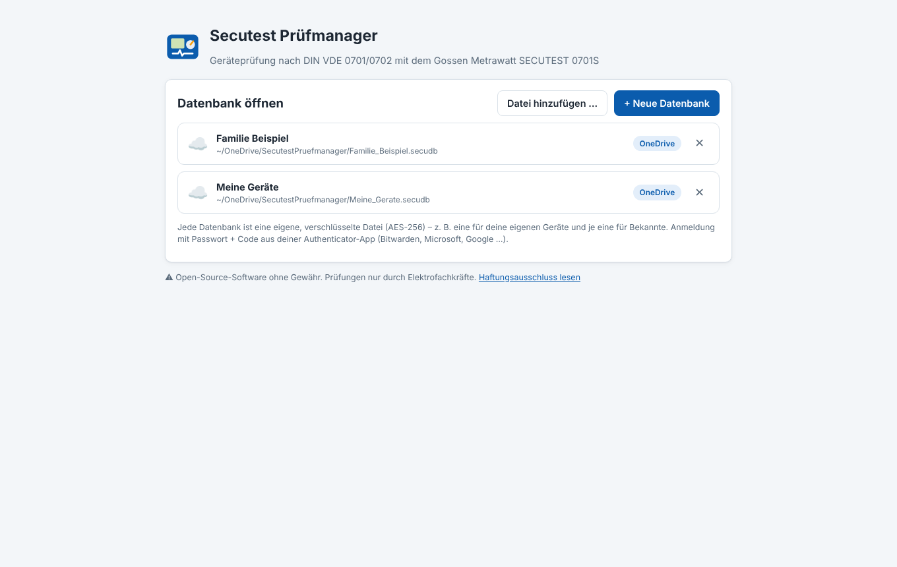 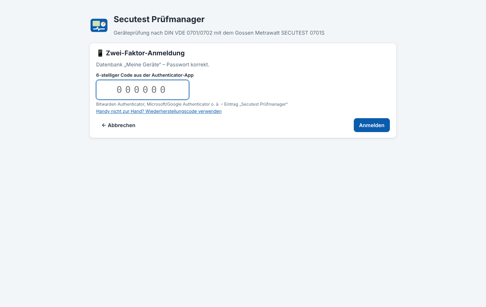

### 5. Gerät anlegen und prüfen

Pflichtangaben sind nur Bezeichnung und Schutzklasse, die Inventarnummer wird automatisch vergeben. Aus der Bezeichnung erkennt das Programm die **Geräteart** und schlägt sie vor (EDV, Heizgerät, Elektronik, Leitung). Bei EDV-Geräten erscheint sofort der Hinweis, dass der AUTO-Modus nicht möglich ist.

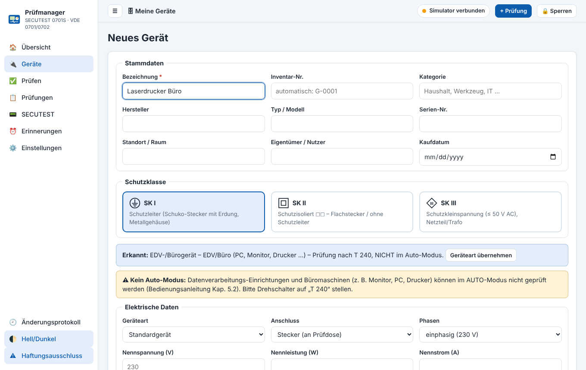

---

## SECUTEST anschließen (RS-232)

1. **USB-RS232-Adapter** am PC einstecken (FTDI, Prolific PL2303, CH340 oder CP210x), ggf. den Treiber installieren.
2. Mit der **9-poligen Buchse RS232 (10)** oben links am SECUTEST verbinden. Meist reicht ein 1:1-Kabel. Kommt keine Antwort, ein **Nullmodem**-Kabel oder einen Nullmodemadapter versuchen.
3. SECUTEST einschalten. Der Drehschalter darf nicht auf OFF stehen.
4. Das Programm **findet das Gerät automatisch** (Auto-Ping mit `IDN?` an allen Ports). Ein eingesteckter Adapter wird sofort erkannt (Hot-Plug). Alternativ: Seite **SECUTEST** → *Automatisch suchen* oder den Port von Hand wählen.

| System | Typischer Port |
|---|---|
| Windows | `COM3`, `COM4` … |
| macOS | `/dev/cu.usbserial-…`, `/dev/cu.usbmodem…` |
| Linux | `/dev/ttyUSB0`, `/dev/ttyACM0` |

Die Seite **SECUTEST** zeigt Status und Geräte-Identität. Dazu kommen ein Live-Monitor, eine Fernbedienung (▲ ▼ ↵ ⓘ FUNCTION-TEST) und ein **Terminal**, über das sich jeder Befehl direkt senden lässt. Unter *Erweiterte Einstellungen* stellst du Adresse, Prüfsumme, Timeout und die Nummern der Schalterstellungen ein.

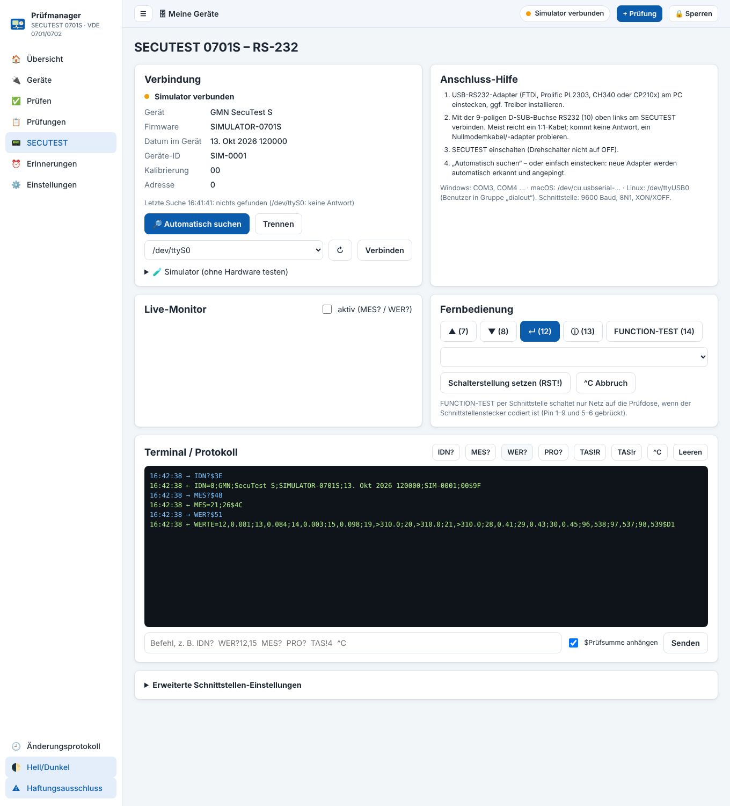

Technische Details zum Protokoll: **[docs/RS232-PROTOKOLL.md](docs/RS232-PROTOKOLL.md)**.

> [!NOTE]
> Die Schnittstelle ist nach Kapitel 8 der Bedienungsanleitung umgesetzt. Mit einem echten Gerät wurde sie bisher **nicht** getestet. Mit dem Simulator und den Tests ist sie geprüft. Weicht dein Gerät ab, hilft das Terminal; Rückmeldungen als Issue sind willkommen.

---

## Prüfen: Betriebsarten

| Betriebsart | Ablauf | Geeignet für |
|---|---|---|
| **SECUTEST – gerätegeführt** (empfohlen) | Du bedienst das SECUTEST wie gewohnt nach dessen Bedienerführung. Das Programm erkennt per `MES?`, welcher Schritt gerade läuft, zeigt Grafik und Live-Werte und übernimmt am Ende **alle** Messwerte samt Sichtprüfungsmängeln per `PRO?` | normale Prüfungen, auch im AUTO-Modus |
| **SECUTEST – PC-gesteuert** | Das Programm macht eine **Anschlusskontrolle** (Kurzschluss, Sonde, Prüfling eingeschaltet, Schutzleiter), startet dann jede Messung selbst (`MES!`), zeigt Live-Werte und übernimmt die WC-Werte (`WER?`) | Einzelmessungen, mehrere Messpunkte, volle Kontrolle |
| **Manuell** | Werte vom Display oder einem anderen Prüfgerät eintippen. Optional berücksichtigt das Programm den Gebrauchsfehler laut Tabelle im Anhang | ohne Schnittstelle, andere Prüfgeräte, Nachtragen |

Der Prüfassistent führt dich durch: **Anschließen → Sichtprüfung → Messungen → Funktionstest → Bewertung**. In jedem Schritt siehst du die Grafik, die nummerierten Handgriffe, Hinweise, die Grenzwerte und eine Ampel für jeden Messwert.
Schritte, die nicht zutreffen, lassen sich **mit Begründung** überspringen, z. B. „keine berührbaren leitfähigen Teile“.

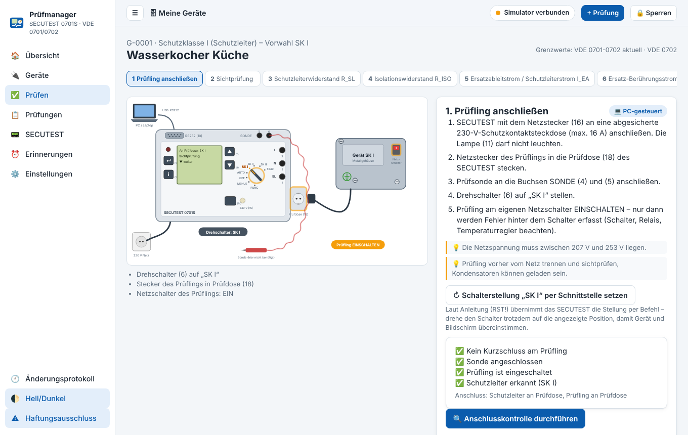 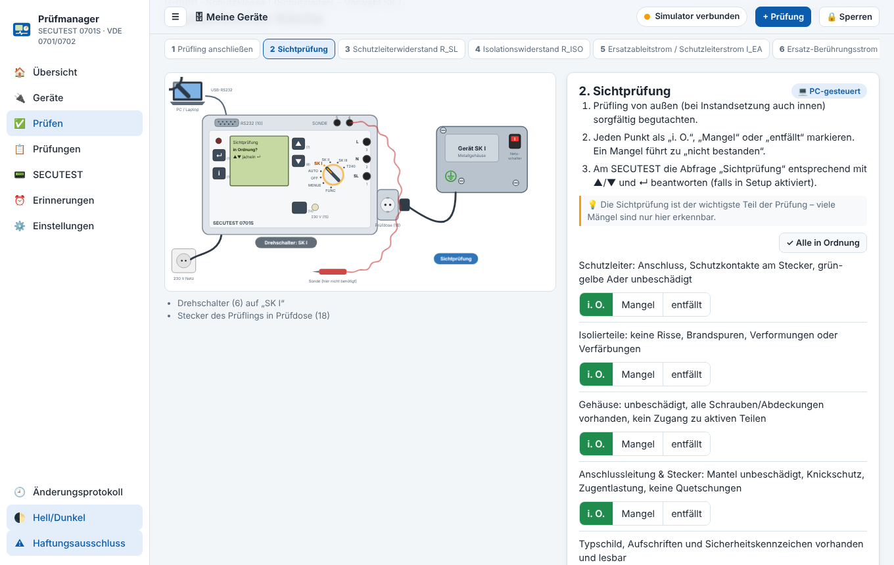

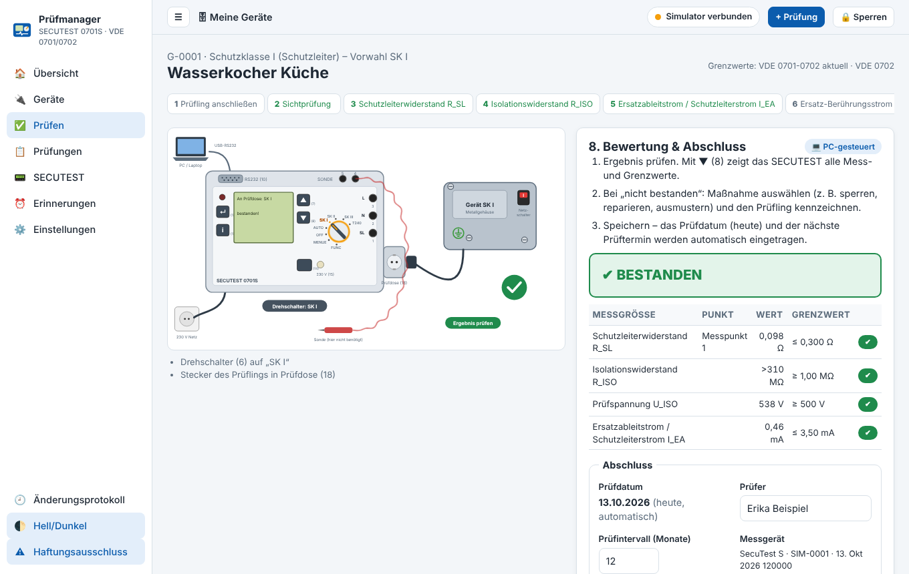

**Prüfdatum und nächster Termin werden automatisch eingetragen.** Das gilt für neue Geräte genauso wie für jede Wiederholungsprüfung: Prüfdatum ist der Prüftag, der nächste Termin ergibt sich aus Prüfdatum plus Prüfintervall.

---

## Prüfabläufe je Schutzklasse

| Ablauf | Drehschalter | Messschritte | Hinweise |
|---|---|---|---|
| **AUTO** | AUTO | Sichtprüfung → R<sub>SL</sub> (nur SK I) → R<sub>ISO</sub> → I<sub>EA</sub> → Funktionstest | Gerät erkennt SK I/II selbst. **Nicht** für SK III, EDV/Büro, Leitungen, Festanschluss. Das Programm sperrt AUTO in diesen Fällen |
| **SK I** | SK I | Sichtprüfung → R<sub>SL</sub> (Leitung bewegen, mehrere Messpunkte) → R<sub>ISO</sub> → I<sub>EA</sub> → optional Berührungsstrom an Teilen ohne PE → Funktionstest | Grenzwert R<sub>SL</sub> hängt von der Leitungslänge ab |
| **SK II** | SK II | Sichtprüfung → R<sub>ISO</sub> mit Sonde je Metallteil → Ersatz-Berührungsstrom je Teil → Funktionstest | schutzisolierte Geräte |
| **SK III** | SK III | Sichtprüfung → R<sub>ISO</sub> (Versorgungsanschlüsse an L/N, spannungsfrei) → optional Versorgungsspannung → Funktionsprüfung | kein Funktionstest an der Prüfdose. R<sub>ISO</sub> entfällt bei ≤ 20 VA und ≤ 42 V |
| **T 240 (EDV/Büro)** | T 240 | Sichtprüfung → R<sub>SL</sub> (SK I) → Berührungsstrom I<sub>Sonde</sub> in **beiden Steckerpositionen** (Netzumpolung) → Funktionstest | keine Isolationsmessung. Unterbricht den Betrieb, Daten vorher sichern |
| **Verlängerungsleitung** | AUTO → Untermenü | Sichtprüfung → R<sub>SL</sub> → R<sub>ISO</sub> → Durchgang/Kurzschluss/Polarität | Zubehör **Adapter EL1**. Kabeltrommeln vorher abwickeln |
| **Festanschluss** | MENUE | Einzelmessungen R<sub>SL</sub>, R<sub>ISO</sub>, I<sub>EA</sub> mit Sonde | Sicherungen entfernen, N auftrennen. Nur durch Elektrofachkräfte |

**Sichtprüfung.** Die Checkliste deckt sich mit den Sichtprüfungs-Bits des SECUTEST: Schutzleiter, Isolierteile, Gehäuse, Anschlussleitung, Typschild, unsachgemäßer Gebrauch. Ergänzt wird sie um Sicherungen, Kühlöffnungen und Bedienteile.

**Funktionstest.** Gemessen werden Differenzstrom ΔI, Netzspannung, Strom, Wirk- und Scheinleistung, Leistungsfaktor und elektrische Arbeit. Er ist nur nach bestandener Sicherheitsprüfung erlaubt. Den Prüfling vor dem Einschalten der Prüfdose am eigenen Schalter **ausschalten**.

---

## Grafische Schritt-Erklärungen

Jeder Schritt zeigt eine vereinfachte Frontansicht des SECUTEST 0701S mit den Nummern aus der Bedienungsanleitung. Zu sehen sind Drehschalter (6), Tasten (7, 8, 12, 13, 14), Buchsen L/N/SL (1–3), Sonde (4/5) und Prüfdose (18). Dazu kommen der Prüfling, die Sonde mit dem markierten Messpunkt und die Handlung, z. B. *Leitung bewegen*, *nicht berühren – 500 V*, *beide Steckerpositionen* oder *Taste 14*.

| | |
|---|---|
| <br><sub>SK I – Schutzleiterwiderstand: Sonde an Metallteil, Leitung bewegen</sub> | <br><sub>SK II – Isolationswiderstand: jedes Metallteil abtasten, nicht berühren</sub> |
| <br><sub>T 240 – Berührungsstrom in beiden Steckerpositionen</sub> | <br><sub>SK III – spannungsfrei, Versorgungsanschlüsse an L/N</sub> |
| <br><sub>Verlängerungsleitung mit Adapter EL1</sub> | <br><sub>Funktionstest: Netz an Prüfdose über Taste 14</sub> |

---

## Grenzwerte & Bewertung

Das Programm bewertet **immer selbst**. Zur Wahl stehen zwei Profile; für jede Prüfung wird gespeichert, welches benutzt wurde.

| Messgröße | Aktuell (DIN VDE 0701-0702:2008 / DIN EN 50678 & 50699) | SECUTEST-Gerätewerte (Stand 1997) |
|---|---|---|
| Schutzleiterwiderstand R<sub>SL</sub> | ≤ 0,3 Ω bis 5 m, je weitere 7,5 m + 0,1 Ω, max. 1 Ω | ≤ 0,3 Ω bis 5 m, + 0,1 Ω je 5 m (0701) bzw. 7,5 m (0702); Festanschluss EDV 1 Ω |
| Isolationswiderstand R<sub>ISO</sub> SK I | ≥ 1 MΩ (Heizelemente > 3,5 kW: ≥ 0,3 MΩ) | ≥ 0,5 MΩ (Heizgeräte: Ausgleich durch bestandenen I<sub>EA</sub>) |
| R<sub>ISO</sub> SK II | ≥ 2 MΩ | ≥ 2 MΩ (elektronisch: Ausgleich durch I<sub>EA</sub>) |
| R<sub>ISO</sub> SK III / Batterie | ≥ 0,25 MΩ (250 V) | ≥ 0,25 MΩ |
| Schutzleiter-/Ersatzableitstrom I<sub>EA</sub> SK I | ≤ 3,5 mA (Heizgeräte ≥ 3,5 kW: 1 mA/kW, max. 10 mA) | ≤ 7 mA (≥ 6 kW: 15 mA; Elektronik: 1 mA bzw. 0,5 mA mehrphasig) |
| Berührungsstrom (SK II / Teile ohne PE) | ≤ 0,5 mA | ≤ 0,5 mA |
| Berührungsstrom I<sub>Sonde</sub> (T 240) | ≤ 0,5 mA | ≤ 0,25 mA |
| Differenzstrom ΔI | SK I wie I<sub>EA</sub>, SK II ≤ 0,5 mA | dto. |
| Versorgungsspannung SK III | ≤ 50 V AC / ≤ 120 V DC | dto. |

* **Gebrauchsfehler:** Werte, die per Schnittstelle kommen, sind *Worst-Case*-Werte und bereits um den Gebrauchsfehler korrigiert. Bei manuell eingegebenen **Anzeigewerten** rechnet das Programm den Grenzwert nach der Tabelle im Anhang der Anleitung auf den zulässigen Anzeigewert um, z. B. 0,3 Ω → 0,275 Ω.
* **Abweichung zum Gerät:** Das SECUTEST von 1997 kennt teils ältere, mildere Grenzwerte, z. B. 7 mA statt 3,5 mA. Meldet das Gerät „bestanden“, das Programm nach aktueller Norm aber „nicht bestanden“, siehst du einen deutlichen Hinweis. Maßgeblich ist die Norm.
* **Vollständigkeit:** Fehlt ein Pflicht-Messwert ohne Begründung oder wurde die Sichtprüfung nicht dokumentiert, gilt die Prüfung als nicht bestanden.

> Grenzwerte ohne Gewähr. Sie sind zentral in `src/vde/limits.js` hinterlegt und dort nachvollziehbar und anpassbar. Maßgeblich sind die jeweils gültigen Normen.

---

## Nicht bestanden – was nun?

Fällt ein Gerät durch, musst du vor dem Speichern eine **Maßnahme** wählen. Der Gerätestatus wird automatisch gesetzt, und bei Bedarf wird das Gerät sofort zur Nachprüfung fällig:

| Maßnahme | Gerätestatus |
|---|---|
| Gerät sperren und kennzeichnen („Defekt – nicht benutzen“) | gesperrt |
| Instandsetzung veranlassen (danach Prüfung nach VDE 0701) | in Reparatur |
| Anschlussleitung / Stecker erneuern und erneut prüfen | in Reparatur |
| Messung wiederholen / Nachprüfung (Verdacht auf Mess- oder Anschlussfehler) | gesperrt |
| An Hersteller / Fachwerkstatt senden (Garantie) | in Reparatur |
| Rückgabe an Eigentümer mit schriftlichem Mängelhinweis | gesperrt |
| Ausmustern / fachgerecht entsorgen (Elektroschrott) | ausgemustert |
| Sonstige Maßnahme (Freitext) | gesperrt |

Gesperrte Geräte erscheinen rot in Übersicht und Liste. Auch ihre Prüfplakette ist rot markiert („GESPERRT – NICHT BENUTZEN“).

---

## Datenbanken, Cloud & Sicherheit

* **Eine Datei pro Datenbank** (`*.secudb`). Für jeden Bekannten legst du eine eigene, komplett getrennte Datenbank an, jeweils mit eigenem Passwort und eigener 2FA.
* **Cloud:** Die Datei liegt z. B. in `OneDrive/SecutestPruefmanager/` oder `iCloud Drive/SecutestPruefmanager/`. Auf anderen Rechnern taucht sie automatisch unter *In der Cloud gefunden* auf.
* **Verschlüsselung:** SQLCipher-kompatibel (AES-256, PBKDF2-HMAC-SHA512). Auch Fotos, SMTP-Passwort und 2FA-Geheimnis liegen nur verschlüsselt in der Datei. Öffnen lässt sie sich zur Not auch mit *DB Browser for SQLite (SQLCipher)*.
* **Sync-Sicherheit:** Das Programm nutzt keinen WAL-Modus, also keine Zusatzdateien, die der Cloud-Sync zerreißen könnte. Eine **Sperrdatei** (`*.lock`) warnt, wenn die Datenbank auf einem anderen Rechner geöffnet ist.
* **Sicherungen:** beim ersten Öffnen jedes Tages automatisch, zusätzlich auf Knopfdruck. Sie landen verschlüsselt im Ordner `Sicherungen` neben der Datei; die letzten 15 bleiben erhalten.
* **Anmeldung:** Passwort plus TOTP-Code mit Schutz gegen wiederverwendete Codes. Nach 5 Fehlversuchen wird 5 Minuten gesperrt. Bei Inaktivität sperrt das Programm automatisch (Standard 15 min) und entfernt dabei den Schlüssel aus dem Speicher.
* **Lokal:** Der Server lauscht nur auf `127.0.0.1`, mit CSRF- und DNS-Rebinding-Schutz.

> **Ehrlicher Hinweis zum Sicherheitsmodell:** Die Verschlüsselung der Datei hängt am **Passwort**. Die Zwei-Faktor-Anmeldung schützt den Zugang über das Programm. Wer Datei *und* Passwort hat, kann sie mit SQLCipher-Werkzeugen öffnen. Wähle daher ein starkes Passwort und verwahre es z. B. in Bitwarden.

Lokale Programmeinstellungen (Liste der Datenbanken, Schnittstelle) liegen in:
Windows `%APPDATA%\SecutestPruefmanager`, macOS `~/Library/Application Support/SecutestPruefmanager`, Linux `~/.config/secutest-pruefmanager`.

---

## Prüferinnerungen per E-Mail & Kalender

* **E-Mail:** SMTP mit Vorlagen für Outlook/Hotmail, iCloud, Gmail, GMX, WEB.DE und T-Online, jeweils mit App-Passwort. Erinnert wird z. B. 30 und 7 Tage vorher, am Fälligkeitstag und danach regelmäßig, solange das Gerät überfällig ist. Jede Erinnerung geht nur einmal raus, alles steht im Versandprotokoll.
* **Kalender:** Nach jeder bestandenen Prüfung kann das Programm eine **Kalendereinladung (.ics)** für den nächsten Termin mailen. Alle Termine lassen sich außerdem als `.ics` exportieren, passend für Outlook, Apple-/iCloud-Kalender, Google und Thunderbird. Kalendertermine erinnern **auch dann, wenn das Programm geschlossen ist**.
* Erinnerung **pro Gerät** ein- und ausschaltbar; Empfänger pro Datenbank, z. B. der Eigentümer.
* E-Mails werden versendet, solange das Programm läuft und die Datenbank entsperrt ist (beim Öffnen und alle 6 h). Für den Betrieb ohne geöffnetes Programm gibt es ein Skript, das du z. B. täglich über die Aufgabenplanung startest:
  ```bash
  npm run reminders -- --db "Meine Geräte"         # Passwort-Abfrage
  SECUTEST_DB_PASSWORD=… npm run reminders -- --db "Meine Geräte"
  ```
  ⚠ Dafür muss das Datenbank-Passwort auf dem Rechner hinterlegt sein. Das nur auf einem eigenen, geschützten Rechner tun.

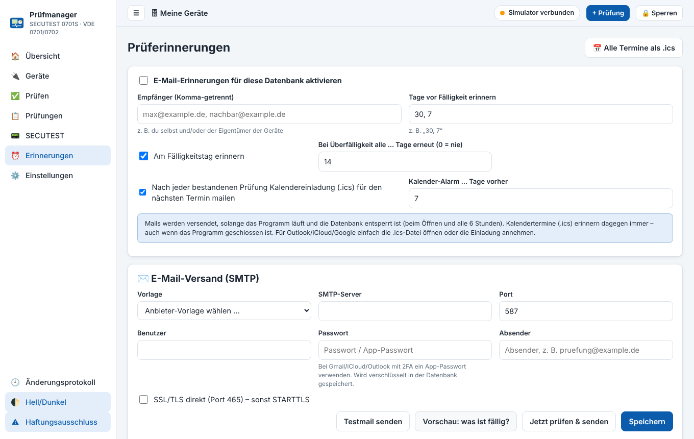

---

## Protokolle, Prüfplaketten, Export

* **Prüfprotokoll** pro Prüfung mit Auftraggeber, Prüfer, Prüfling, Norm, Ablauf, Messgerät, Sichtprüfung, allen Messwerten samt Grenzwerten, Funktionstest, Gesamtergebnis, Maßnahme, nächstem Termin und Unterschriftsfeld. Im Browser drucken oder als PDF speichern.
* **Prüfplaketten** (62 × 34 mm) mit Inventarnummer, Prüfdatum, nächster Prüfung (MM/JJJJ) und QR-Code, zum Ausdrucken auf Etiketten.
* **Fotos & PDFs** pro Gerät (Typschild, Mängel), verschlüsselt gespeichert und automatisch verkleinert.
* **Export:** CSV (Excel) und JSON (komplette Daten). Dazu ein **Änderungsprotokoll** aller Aktionen.

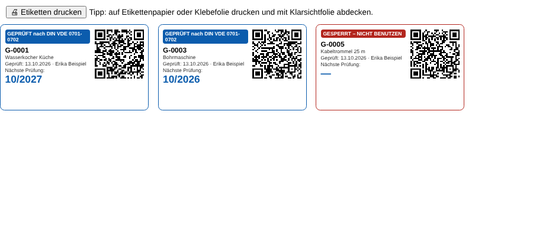

---

## Gespeicherte Daten

| Tabelle | Inhalt |
|---|---|
| `devices` | Inventar-Nr., Bezeichnung, Hersteller, Typ, Seriennummer, Kategorie, Schutzklasse, Geräteart, Anschlussart, Phasen, Nennspannung/-leistung/-strom, Heizleistung, Leitungslänge und Querschnitt, Standort, Eigentümer, Kaufdatum, Prüfintervall, Status, Erinnerung, letzte Prüfung und Ergebnis, nächster Termin, Notizen |
| `inspections` | Prüfdatum, Start und Ende, Norm (0701/0702), Anlass, Ablauf, Betriebsart, Schutzklasse, Grenzwertprofil, Prüfer, Ergebnis, Bewertung des SECUTEST, Maßnahme, Intervall, nächster Termin, Messgerät (IDN), Rohdaten (`PRO?`), Bemerkungen |
| `measurements` | je Messwert: Messgröße (R<sub>SL</sub>, R<sub>ISO</sub>, U<sub>ISO</sub>, I<sub>EA</sub>, I<sub>B</sub>, I<sub>Sonde</sub>, ΔI, U<sub>AC/DC</sub>, U, I, P, S, λ, W, f …), Messpunkt, Wert, Originalanzeige (z. B. `>310.0`), Einheit, Grenzwert, Vergleich, Ergebnis, Quelle |
| `inspection_checks` | Sicht- und Funktionsprüfung je Punkt (i. O. / Mangel / entfällt) mit Notiz, entfallene Schritte mit Begründung |
| `attachments` | Fotos und PDFs |
| `reminder_log`, `audit_log` | versendete Erinnerungen, Änderungsprotokoll |

---

## Entwicklung & automatische Releases

```
src/
  server.js            Express-Server (nur 127.0.0.1), Sicherheits-Header, Selbsttest
  config.js            lokale App-Konfiguration
  auth/                TOTP (RFC 6238), Sitzungen, Wiederherstellungscodes
  db/                  SQLCipher-Datenbank, Schema/Migrationen, Cloud-Ordner, Datenzugriff
  vde/                 Grenzwerte, Prüfabläufe je Schutzklasse, Bewertung, Maßnahmen
  secutest/            RS-232-Protokoll, Treiber, Auto-Ping/Hot-Plug, Simulator, Manager
  reminders/           SMTP-Mails, iCalendar, Zeitplan
  report/              Prüfprotokoll & Prüfplaketten
  routes/              REST-API
public/                Oberfläche (HTML/CSS/JavaScript-Module, ohne Build-Schritt)
  js/illustrations.js  SVG-Grafiken der Prüfschritte
scripts/               build-release.js (portable Pakete), send-reminders.js
test/                  Tests (node:test) – Protokoll, TOTP, Grenzwerte, DB, Simulator, API
```

* **Technik:** Node.js (JavaScript, kein Build-Schritt), Express, better-sqlite3-multiple-ciphers (SQLCipher), serialport, nodemailer, qrcode.
* **Tests:** `npm test` (über 30 Tests). `npm run simulator` startet das Programm mit simuliertem SECUTEST und mehreren Szenarien, auch mit Fehlerfällen.
* **CI:** Jeder Pull Request wird unter Windows, macOS und Linux getestet (`.github/workflows/ci.yml`).
* **Releases:** Jeder Push bzw. Merge auf `main` löst `.github/workflows/release.yml` aus: Tests → Pakete für Windows, macOS (arm64/x64) und Linux mit gebündeltem Node.js bauen → **Selbsttest der Pakete** auf Windows, macOS und Linux → Veröffentlichung als GitHub-Release `v<Version>-build.<Nr>`. So liegt immer die neueste ausführbare Version unter *Releases*.
* Pakete lokal bauen: `node scripts/build-release.js` (alle Plattformen) oder `node scripts/build-release.js --only linux-x64 --local-node`.

Beiträge sind willkommen. Bitte vor einem Pull Request `npm test` ausführen.

---

## Ideen für weitere Funktionen

Vorschläge, die für Prüfer besonders nützlich wären:

1. **Prüfmittelverwaltung:** Kalibrierdatum des SECUTEST hinterlegen und vor Ablauf warnen; die Kalibrierung landet im Protokoll.
2. **Barcode/QR-Scanner:** Prüfplakette mit Handy oder USB-Scanner einlesen, und das Gerät öffnet sich direkt zur Prüfung.
3. **Serienprüfung:** mehrere gleiche Geräte, z. B. 20 Verlängerungen, nacheinander prüfen, wobei Daten des Vorgängers übernommen werden.
4. **Gefährdungsbeurteilung & Intervallvorschlag** nach DGUV Vorschrift 3 / TRBS 1201 (Baustelle, Werkstatt, Büro).
5. **Kunden- und Auftragsverwaltung** mit Sammelprotokoll und Rechnung bzw. Prüfbericht für Bekannte als PDF.
6. **Digitale Unterschrift** von Prüfer und Kunde direkt am Tablet oder mit der Maus.
7. **Statistiken:** Ausfallquoten nach Kategorie, Hersteller und Alter, Trend der Messwerte über Jahre, etwa ein langsam steigender Ableitstrom als Frühwarnung.
8. **Mobil-Ansicht / PWA** für Tablet-Bedienung am Prüfplatz.
9. **Import** aus PC.doc/PS3 oder CSV, um bestehende Geräte zu übernehmen.
10. **SECUTEST PSI** (Drucker-/Speichermodul) auslesen und Autostore-Protokolle importieren.
11. **Sprachausgabe/Signalton** bei Grenzwertverletzung und für Schrittansagen, damit die Hände frei bleiben.
12. **Weitere Prüfgeräte** (SECUTEST S2N+, BENNING ST 725, Fluke 6500), sofern deren Protokolle offen sind.
13. **Hersteller-Prüfanweisungen** pro Gerätetyp als Vorlage hinterlegen.
14. **Mehrbenutzer** mit Rollen (Prüfer/Leser) und Protokollfreigabe.

---

## Fehlerbehebung (FAQ)

<details><summary><b>Das SECUTEST wird nicht gefunden</b></summary>

* Ist der Adapter-Treiber installiert? Unter Windows im Geräte-Manager unter „Anschlüsse (COM & LPT)“ nachsehen.
* SECUTEST eingeschaltet, Drehschalter nicht auf OFF?
* 1:1- statt Nullmodemkabel probieren oder umgekehrt.
* Seite **SECUTEST** → *Automatisch suchen* zeigt pro Port das Ergebnis. Im **Terminal** testweise `IDN?` senden, auch einmal ohne Prüfsumme.
* Linux: Benutzer in Gruppe `dialout`? macOS: `/dev/cu.*` statt `/dev/tty.*` verwenden (macht das Programm automatisch).
</details>

<details><summary><b>„Die Datenbank ist vermutlich auf … geöffnet“</b></summary>

Die Datenbank ist auf einem anderen Rechner offen oder das Programm wurde nicht sauber beendet. Schließe sie dort. Wenn das nicht geht, z. B. nach einem Absturz, wähle *Trotzdem öffnen*. Gleichzeitiges Arbeiten auf zwei Rechnern über die Cloud kann Änderungen überschreiben.
</details>

<details><summary><b>Handy verloren / neue Authenticator-App</b></summary>

Melde dich mit einem **Wiederherstellungscode** an und richte unter *Einstellungen → Sicherheit → 2FA neu einrichten* die neue App ein. Danach am besten neue Wiederherstellungscodes erzeugen.
</details>

<details><summary><b>Code wird abgelehnt</b></summary>

Die Uhrzeit von PC und Handy muss stimmen (automatische Zeit aktivieren). Jeder Code gilt nur einmal, also gegebenenfalls den nächsten abwarten.
</details>

<details><summary><b>Konflikt-Kopien in OneDrive/iCloud („… (1).secudb“, „…-PCNAME.secudb“)</b></summary>

Die entstehen, wenn auf zwei Rechnern gleichzeitig geändert wurde. Öffne beide Dateien und übertrage die fehlenden Prüfungen. Im Zweifel hilft der JSON-Export oder eine Sicherung.
</details>

<details><summary><b>Port 3701 belegt</b></summary>

Läuft das Programm bereits? Sonst mit `--port 3702` starten.
</details>

---

## Haftungsausschluss

* **Nur für Fachpersonal:** Prüfungen nach DIN VDE 0701/0702 (DIN EN 50678 / DIN EN 50699) und alle Arbeiten an elektrischen Anlagen und Geräten dürfen nur von **Elektrofachkräften** durchgeführt werden, oder von elektrotechnisch unterwiesenen Personen unter Leitung und Aufsicht einer Elektrofachkraft. Elektrischer Strom ist lebensgefährlich.
* **Open Source ohne Gewähr:** Diese Software wird „wie besehen“ ohne jegliche Gewährleistung bereitgestellt. Sie **kann Fehler enthalten**, insbesondere bei Grenzwerten, Bewertungen, der RS-232-Kommunikation und den grafischen Anleitungen.
* **Kein Ersatz für Fachwissen:** Die Software ersetzt weder die Bedienungsanleitung des Prüfgeräts noch die geltenden Normen und Vorschriften (z. B. DGUV Vorschrift 3) noch die fachliche Beurteilung durch die verantwortliche Elektrofachkraft. Jede automatische Bewertung ist von der prüfenden Person zu kontrollieren. Im Zweifel gilt ein Gerät als nicht bestanden.
* **Keine Haftung:** Die Autoren und Mitwirkenden übernehmen, soweit gesetzlich zulässig, **keinerlei Haftung für Personen-, Sach- oder Vermögensschäden**, die direkt oder indirekt durch die Nutzung, Fehlfunktion oder fehlerhafte Ergebnisse dieser Software entstehen. Die Nutzung erfolgt ausschließlich auf eigene Verantwortung.
* **Marken:** Gossen Metrawatt und SECUTEST sind Marken der jeweiligen Inhaber. Dieses Projekt ist unabhängig und steht in keiner Verbindung zur GMC-I Messtechnik GmbH. Für das Prüfgerät gilt ausschließlich dessen Bedienungsanleitung.

## Lizenz

[MIT](LICENSE). Frei nutzbar, veränderbar und weitergebbar, jeweils mit Lizenz- und Haftungshinweis.
